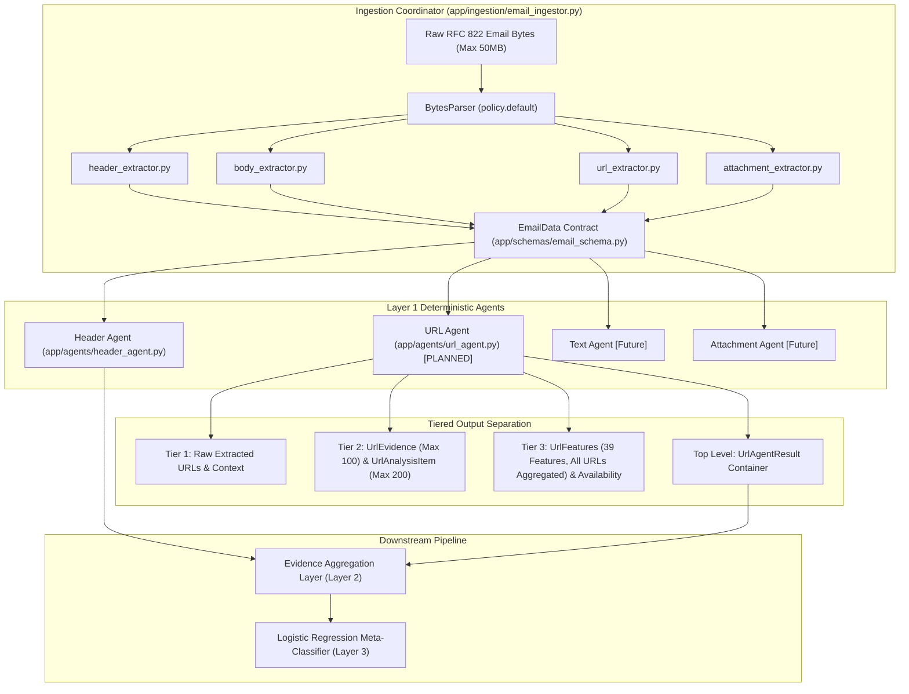
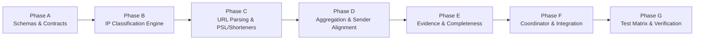
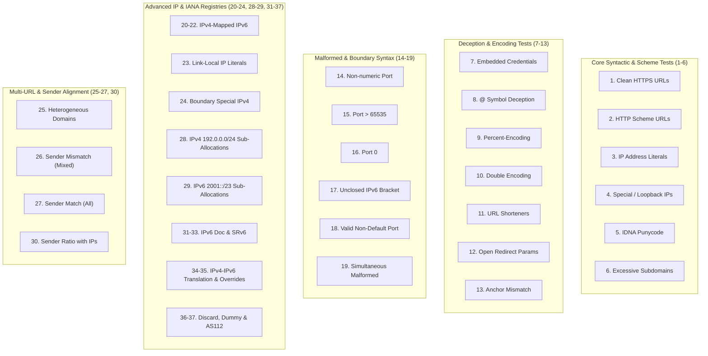
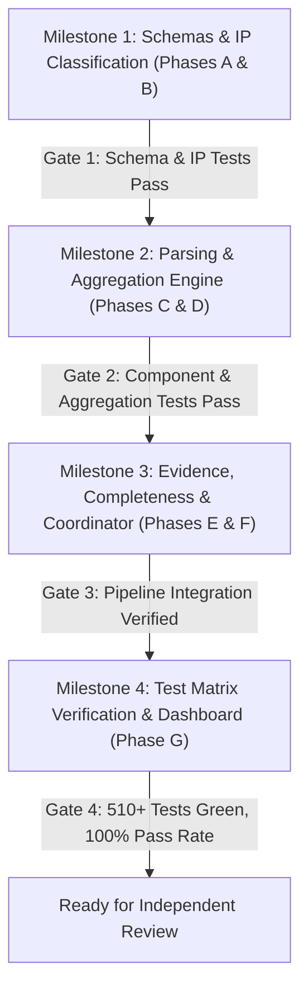

# URL Agent Implementation Plan (Task 9.1.1 Revision)

**Specification Reference**: `docs/url_agent_design.md` (Revision v1.10.0)  
**Target Component**: Layer 1 Deterministic URL Feature Extraction Agent (`url_agent`)  
**Status**: PLANNING ONLY — Awaiting Review & Explicit Approval  
**Revision**: v1.1.0 (Task 9.1.1 Corrections Applied)  
**Date**: November 2026  

---

## Executive Summary

This document specifies the revised, phased implementation plan for the **URL Agent** (`url_agent`), the second specialized Layer 1 feature extraction agent in the Multi-Agent AI Phishing Email Detector pipeline.

Following the approved v1.10.0 design specification (`docs/url_agent_design.md`), the URL Agent is a **strictly passive, deterministic, offline feature extractor**. It extracts exactly **39 canonical features** (36 active, 3 quarantined) from `EmailData.extracted_urls` and evaluates identity alignment against `EmailData.headers.from_address`.

### Mandatory Design Corrections (v1.1.0 Revision)
1. **URL Processing Limits**:
   - **Per-URL Detailed Analysis Cap**: Output list of `UrlAnalysisItem` is capped at **200 records**.
   - **Forensic Evidence Cap**: `UrlEvidence.evidence_items` is capped at **100 records**.
   - **Anomalous Hostnames Cap**: `UrlEvidence.detected_anomalous_hostnames` is capped at **50 hostnames**.
   - **Full Aggregate Feature Calculations**: Aggregate features (`total_url_count`, `unique_url_count`, `https_url_count`, ratios, maximums, and flags) **must and do account for ALL extracted URLs** (e.g., across 500 or 3,134 URLs). Evidence capping and detailed analysis record capping **never** truncate aggregate feature extraction.
2. **Removal of Risk Assessment**:
   - `UrlRiskAssessment` is completely removed from schemas, plans, and contracts. The URL Agent produces **zero** risk predictions, probabilities, confidence scores, or phishing verdicts.
3. **Exact `DomainResolutionStatus` Contract**:
   - Strictly enforces the seven approved enum values: `EXACT_MATCH`, `WILDCARD_MATCH`, `EXCEPTION_MATCH`, `UNKNOWN_SUFFIX`, `INVALID_HOSTNAME`, `IP_LITERAL`, and `NO_HOSTNAME`.
4. **Complete IPv6 Registry Coverage**:
   - Exhaustively enumerates all **25 entries** in the IANA IPv6 Special-Purpose Address Registry (11 inside `2001::/23` and 14 outside `2001::/23`).
   - Categorizes IPv6 multicast (`ff00::/8`) under RFC 4291 / IANA IPv6 Address Space registry, keeping it strictly separate from the special-purpose unicast registry.
5. **Two-Pronged Punycode Detection**:
   - Inspects both the **normalized hostname** (`ExtractedURL.hostname` for `xn--` prefix) and the **raw hostname** parsed from `ExtractedURL.original_url` for non-ASCII characters (`ord(c) > 127`). Non-ASCII characters in URL paths or queries do **not** trigger Punycode detection.
6. **Measurable Performance Benchmarks**:
   - Replaces unconditional `< 50 ms` claims with measurable benchmark targets across typical emails (1–10 URLs), 200 URLs, 500 URLs, and worst-case 3,134-URL digest bombs.
7. **Explicit Quarantined Feature Semantics**:
   - Documents distinct values and availability semantics for Feature 4 (`http_url_count`), Feature 27 (`has_brand_in_path`), and Feature 39 (`has_form_action_url`).

**STRICT CONSTRAINT CONFIRMATION**: This document represents a **PLANNING ONLY** milestone. Zero implementation code, schemas, ingestion modifications, or tests have been created or modified.

---

## 1. Current Architecture Assessment

### 1.1 Ingestion Pipeline & Data Flow
The email processing pipeline follows a unidirectional, passive processing architecture:

### 1.2 Pipeline Invariants & URL Agent Responsibilities
1. **Passive Operation**: The URL Agent performs **zero network requests**, zero DNS queries, zero WHOIS lookups, zero live HTTP fetches, and zero external reputation API calls.
2. **Deterministic Processing**: Given an identical `EmailData` input, the agent produces bit-for-bit identical feature vectors, availability masks, and forensic evidence items across all runs and platforms.
3. **No Duplicate URL Extraction**: The agent consumes `EmailData.extracted_urls` directly. It never re-extracts URLs from `EmailData.plain_text_body` or `EmailData.html_body`.
4. **Leakage Prevention**: Raw URL strings, target hostnames, full query strings, anchor text snippets, and corpus identifiers are strictly restricted to Tier 2 evidence containers. Tier 3 predictive feature space (`UrlFeatures`) contains only sanitized booleans, counts, lengths, and ratios.
5. **No Phishing Verdict**: The URL Agent extracts observable structural measurements and identity alignment features. It never computes phishing probabilities, confidence scores, risk categories, or binary classification decisions.

### 1.3 Processing Caps vs. Full Aggregate Coverage
To prevent denial-of-service and unbounded memory growth from large emails while preserving complete statistical accuracy, the design enforces a strict distinction between **output container caps** and **aggregate feature extraction**:

- **Per-URL Detailed Analysis Record Cap ($N_{\text{analysis\_cap}} = 200$)**:
  - The `UrlAgentResult.analysis_items` list contains at most 200 `UrlAnalysisItem` records representing the first 200 extracted URLs in extraction order.
  - If `len(EmailData.extracted_urls) > 200`, the agent sets `url_count_capped = True` in metadata/warnings, but retains detailed records only for the first 200 URLs.
- **Forensic Evidence Container Cap (Max 100 items)**:
  - `UrlEvidence.evidence_items` is bounded by Pydantic constraint `max_length=100`.
- **Anomalous Hostnames Container Cap (Max 50 items)**:
  - `UrlEvidence.detected_anomalous_hostnames` is bounded by Pydantic constraint `max_length=50`.
- **Full Aggregate Feature Coverage Guarantee**:
  - **Aggregate feature extraction is NEVER truncated by the 200-URL analysis cap or the 100-item evidence cap.**
  - All 39 canonical features in `UrlFeatures` (including `total_url_count`, `unique_url_count`, `https_url_count`, `has_ip_literal_url`, `domain_match_ratio`, `sender_domain_mismatch_ratio`, `max_subdomain_depth`, etc.) are computed over **every single URL** in `EmailData.extracted_urls`.
  - *Example*: For an email containing 500 URLs:
    - Detailed `analysis_items` contains exactly 200 items.
    - `UrlEvidence.evidence_items` contains at most 100 items.
    - `total_url_count` evaluates to **500**.
    - Ratios, counts, and boolean flags account for all 500 URLs.

### 1.4 Algorithmic Complexity & Performance Benchmark Targets
- **Time Complexity**: $\mathcal{O}(N \cdot L)$ where $N$ is total URL count and $L$ is URL character length. The agent processes URLs in a streaming single pass.
- **Space Complexity**: $\mathcal{O}(N)$ working memory for identity tracking sets (set of observed normalized URLs, set of observed domain identities, set of observed FQDNs). For the development corpus maximum of $N = 3,134$, working memory requires $\approx 313\text{ KB}$, remaining strictly bounded. Output payload storage is strictly $\mathcal{O}(1)$ bounded by constant caps.
- **Measurable Performance Benchmark Targets** (Reference hardware: Modern x86_64, Python 3.11–3.13):
  - **Typical Email (1–10 URLs)**: Target $< 25\text{ ms}$ processing time.
  - **200 URLs Benchmark**: Target $< 100\text{ ms}$ processing time.
  - **500 URLs Benchmark**: Target $< 250\text{ ms}$ processing time (full aggregation across all 500 URLs, 200 detailed analysis records).
  - **3,134 URLs Worst-Case Digest Bomb**: Target $< 1,500\text{ ms}$ processing time (full aggregation across all 3,134 URLs, bounded output records).
  - *Design Invariant*: Performance targets are benchmarks, not hard real-time guarantees; full aggregate accuracy is never sacrificed to meet a latency cutoff.

---

## 2. Existing Interfaces and Contracts to Reuse

The URL Agent integrates seamlessly with the existing codebase without modifying any upstream schemas or ingestion extractors.

### 2.1 Inputs from `app/schemas/email_schema.py`
The agent consumes the following existing fields from `EmailData`:
- `email_id: str`: Unique identifier propagated to `UrlAgentResult.email_id`.
- `headers.from_address: Optional[str]`: Raw `From` header string used to extract the sender mailbox and authoritative registered domain.
- `extracted_urls: list[ExtractedURL]`: Ordered list of extracted URLs from body and HTML markup. Each `ExtractedURL` provides:
  - `original_url: str`: Raw URL string as extracted (used for raw hostname parsing and Unicode character check `ord(c) > 127`).
  - `normalized_url: Optional[str]`: Normalized URL string (if populated by extractor).
  - `source: URLSource`: Enumeration (`PLAIN_TEXT`, `HTML_HREF`, `HTML_SRC`, `HTML_OTHER`, `HEADER`).
  - `anchor_text: Optional[str]`: Visible anchor text for HTML hyperlinks (used for anchor-destination mismatch detection).
  - `scheme: Optional[str]`, `hostname: Optional[str]`, `path: Optional[str]`, `query: Optional[str]`: Pre-parsed structural components (where `hostname` is inspected for `xn--` Punycode labels).

### 2.2 Reusable Utilities & Design Patterns from Header Agent
- **Sanitization Utility**: `app.agents.header_agent.sanitize_evidence_snippet(raw_str, max_len=256)` escapes ASCII control characters, replaces newlines/tabs with spaces, and truncates safely.
- **Verification Status**: `app.schemas.email_schema.VerificationStatus.UNVERIFIED` applied to all Tier 2 evidence items to indicate offline unverified observations.
- **Schema Design Patterns**:
  - `CANONICAL_URL_FEATURE_NAMES`: Pydantic `Literal[...]` covering all 39 features in continuous 1..39 index order.
  - `CANONICAL_URL_FEATURE_LIST`: Immutable ordered tuple of feature names.
  - `UrlFeatureAvailability`: Dedicated boolean manifest mapping every feature to its availability state.
  - `UrlEvidenceItem`: Structured forensic evidence record with bounded snippet, finding ID, and URL index.
  - `UrlAgentResult`: Top-level container with `email_id`, `status`, `processing_time_ms`, `features`, `availability`, `evidence`, `warnings`, and `limitations`.
  - **No Risk Assessment**: Downstream classification is deferred strictly to Layer 2 / Layer 3 meta-classifiers.

---

## 3. Proposed Implementation Phases

We recommend a 7-phase implementation structure (Phases A through G) executed in logical dependency order:

---

### Phase A: URL Agent Schemas & Data Contracts
- **Primary Goal**: Establish immutable Pydantic v2 data contracts for the URL Agent, guaranteeing exact alignment with the 39-feature registry in v1.10.0, without risk prediction models.
- **Files to Create**:
  1. `app/schemas/url_agent_schema.py`: All data models, literals, feature vectors, and result containers.
  2. `tests/test_url_agent_schema.py`: Comprehensive contractual schema tests.
- **Classes, Types, and Literals**:
  - `CANONICAL_URL_FEATURE_NAMES`: Literal of all 39 feature names (1..39).
  - `CANONICAL_URL_FEATURE_LIST`: Tuple of 39 string feature names.
  - `ACTIVE_URL_FEATURES`: Set of 36 active feature names.
  - `QUARANTINED_URL_FEATURES`: Set of 3 quarantined features (`http_url_count`, `has_brand_in_path`, `has_form_action_url`).
  - `DomainResolutionStatus`: String Enum with exactly **seven** approved statuses:
    - `EXACT_MATCH = "exact_match"`: Hostname suffix exactly matches a PSL rule.
    - `WILDCARD_MATCH = "wildcard_match"`: Hostname suffix matches a PSL wildcard rule (`*.ck`).
    - `EXCEPTION_MATCH = "exception_match"`: Hostname matches a PSL exception rule (`!www.ck`).
    - `UNKNOWN_SUFFIX = "unknown_suffix"`: Valid hostname structure but suffix not in PSL snapshot.
    - `INVALID_HOSTNAME = "invalid_hostname"`: Fails structural validation (empty, whitespace, bad chars).
    - `IP_LITERAL = "ip_literal"`: Hostname is an IPv4 or IPv6 address literal.
    - `NO_HOSTNAME = "no_hostname"`: URL has no hostname component (e.g. `data:`, `mailto:`).
  - `UrlAnalysisItem`: Detailed per-URL intermediate analysis container (max 200 items in output result).
  - `UrlEvidenceItem`: Forensic evidence trace supporting an observed feature or anomaly.
  - `UrlEvidence`: Container for Tier 2 forensic evidence (max 100 items, max 50 anomalous hosts, max 100 anomalies).
  - `UrlFeatures`: Sanitized Tier 3 feature vector containing exactly 39 features.
  - `UrlFeatureAvailability`: Boolean availability manifest for all 39 features.
  - `UrlAgentResult`: Top-level output container (aliased as `UrlAgentOutput`). Note: Contains `analysis_items: list[UrlAnalysisItem] = Field(default_factory=list, max_length=200)`.
  - **Explicit Removal**: `UrlRiskAssessment` is **not** included.
- **Quarantined Feature Field Definitions**:
  - `http_url_count`: `int = Field(ge=0, description="Count of URLs with scheme == 'http'. Quarantined from primary predictive model.")`
  - `has_brand_in_path`: `Optional[bool] = Field(default=None, description="Quarantined feature; always None.")`
  - `has_form_action_url`: `Optional[bool] = Field(default=None, description="Quarantined feature; always None.")`
- **Unit Tests**:
  - Test exact 39-feature count, uniqueness, and category partitioning (A: 6, B: 13, C: 8, D: 7, E: 5).
  - Test quarantined features classification (`http_url_count`, `has_brand_in_path`, `has_form_action_url`).
  - Test all 7 `DomainResolutionStatus` values.
  - Test field-level validators, evidence bounds (max 100), anomalous host bounds (max 50), analysis items bounds (max 200), and JSON serialization.
- **Acceptance Criteria**: `pytest tests/test_url_agent_schema.py` passes 100% with zero warnings.

---

### Phase B: Deterministic IP Classification Utilities
- **Primary Goal**: Implement RFC-compliant, versioned, deterministic IP address classification with exhaustive IANA Special-Purpose Address Registry coverage and longest-prefix override logic.
- **Files to Create/Modify**:
  1. `app/utils/ip_classifier.py`: Standalone, reusable IP classification module.
  2. `tests/test_ip_classifier.py`: Dedicated unit tests covering all IANA allocations and exceptions.
- **Key Responsibilities & Invariants**:
  - **Dual-Date Registry Provenance**:
    - *IANA Source Registries Last Updated*: **October 9, 2025**
    - *Project Snapshot Capture Date*: **November 15, 2026**
  - **IPv4-Mapped IPv6 Unwrapping**: Detect `::ffff:x.x.x.x` using `ip.ipv4_mapped` and classify the embedded IPv4 address under IPv4 rules before applying any IPv6 rules.
  - **RFC 4291 Multicast Isolation**: Classify IPv6 multicast (`ff00::/8`) under RFC 4291 / IANA IPv6 Address Space registry (`multicast`); do **not** attribute it to the IANA IPv6 Special-Purpose Address Registry.
  - **Exhaustive IPv4 Sub-Allocations in `192.0.0.0/24` (RFC 6890)**:
    - `192.0.0.9/32`, `192.0.0.10/32` (PCP / TURN Anycast) $\implies$ `syntactically_global` (`Globally Reachable: True`).
    - `192.0.0.0/29` (DS-Lite / Service Continuity) $\implies$ `special_purpose` (`Globally Reachable: False`).
    - `192.0.0.8/32` (Dummy IPv4 Prefix, RFC 7600) $\implies$ `special_purpose` (`Globally Reachable: False`).
    - `192.0.0.170/32`, `192.0.0.171/32` (NAT64/DNS64 Discovery, RFC 7050) $\implies$ `special_purpose` (`Globally Reachable: False`).
    - `192.0.0.0/24` (remainder) $\implies$ `special_purpose` (`Globally Reachable: False`).
  - **Exhaustive IPv6 Special-Purpose Address Registry Audit (All 25 Entries)**:
    - **11 Entries within `2001::/23` (Section 9.1.5)**:
      1. `2001:1::1/128` (PCP Anycast, RFC 7723) $\implies$ `syntactically_global` (IANA True).
      2. `2001:1::2/128` (TURN Anycast, RFC 8155) $\implies$ `syntactically_global` (IANA True).
      3. `2001:1::3/128` (DNS-SD SRP Anycast, RFC 9665) $\implies$ `syntactically_global` (IANA True).
      4. `2001:3::/32` (Automatic Multicast Tunneling AMT, RFC 7450) $\implies$ `syntactically_global` (IANA True).
      5. `2001:4:112::/48` (AS112-v6, RFC 7535) $\implies$ `syntactically_global` (IANA True).
      6. `2001:20::/28` (ORCHIDv2, RFC 7343) $\implies$ `syntactically_global` (IANA True).
      7. `2001:30::/28` (Drone Remote ID Entity Tags, RFC 9374) $\implies$ `syntactically_global` (IANA True).
      8. `2001::/32` (TEREDO, RFC 4380, RFC 8190) $\implies$ `special_purpose` (IANA N/A, conservative tunneling policy).
      9. `2001:2::/48` (BMWG Benchmarking, RFC 5180) $\implies$ `special_purpose` (IANA False).
      10. `2001:10::/28` (Deprecated Sub-TLA, RFC 4843, RFC 7343, Term. 2014-03) $\implies$ `special_purpose` (IANA [Blank]).
      11. `2001::/23` (remainder, IETF Protocol Assignments, RFC 2928) $\implies$ `special_purpose` (IANA False, unless allowed by more-specific).
    - **14 Entries outside `2001::/23` (Section 9.1.6)**:
      1. `::1/128` (Loopback Address, RFC 4291) $\implies$ `loopback` (IANA False, Precedence 1).
      2. `::/128` (Unspecified Address, RFC 4291) $\implies$ `special_purpose` (IANA False, Precedence 6).
      3. `::ffff:0:0/96` (IPv4-mapped Address, RFC 4291) $\implies$ Unwrapped to IPv4 before classification (IANA False).
      4. `64:ff9b::/96` (IPv4-IPv6 Translation Well-Known, RFC 6052) $\implies$ `syntactically_global` (IANA True, Precedence 7, outside `2000::/3`).
      5. `64:ff9b:1::/48` (IPv4-IPv6 Translation Local-Use, RFC 8215) $\implies$ `special_purpose` (IANA False, Precedence 6).
      6. `100::/64` (Discard-Only Address Block, RFC 6666) $\implies$ `special_purpose` (IANA False, Precedence 6).
      7. `100:0:0:1::/64` (Dummy IPv6 Prefix, RFC 9780) $\implies$ `special_purpose` (IANA False, Precedence 6).
      8. `2001:db8::/32` (Documentation Prefix, RFC 3849) $\implies$ `documentation` (IANA False, Precedence 4, subnet of `2000::/3`, overrides global fallback).
      9. `2002::/16` (6to4 Anycast / Transition, RFC 3056, RFC 7526) $\implies$ `special_purpose` (IANA N/A, Precedence 6, subnet of `2000::/3`, overrides global fallback).
      10. `2620:4f:8000::/48` (Direct Delegation AS112 Service, RFC 7534) $\implies$ `syntactically_global` (IANA True, Precedence 7, subnet of `2000::/3`).
      11. `3fff::/20` (Documentation Prefix, RFC 9637) $\implies$ `documentation` (IANA False, Precedence 4, subnet of `2000::/3`, overrides global fallback).
      12. `5f00::/16` (Segment Routing SRv6 SIDs, RFC 8986, RFC 9602) $\implies$ `special_purpose` (IANA False, Precedence 6).
      13. `fc00::/7` (Unique Local Unicast ULA, RFC 4193) $\implies$ `rfc4193` (IANA False, Precedence 8).
      14. `fe80::/10` (Link-Local Unicast, RFC 4291) $\implies$ `link_local` (IANA False, Precedence 2).
  - **Separately Handled Categories & Fallback**:
    - **IPv6 Multicast**: `ff00::/8` (RFC 4291) $\implies$ `multicast` (Precedence 3, not in special-purpose unicast registry).
    - **Global Unicast Fallback**: `2000::/3` $\implies$ `syntactically_global` (Precedence 9, reached only after all documentation and special-purpose overrides).
- **Unit Tests**: Test scenarios 3, 4, 20, 21, 22, 23, 24, 28, 29, 31, 32, 33, 34, 35, 36, 37.
- **Acceptance Criteria**: 100% agreement between implementation and Section 9.1 of `docs/url_agent_design.md`.

---

### Phase C: URL Parsing & Per-URL Analysis
- **Primary Goal**: Implement single-pass URL structural parsing, offline PSL resolution, offline shortener lookup, two-pronged Punycode detection, and individual `UrlAnalysisItem` extraction.
- **Files to Create/Modify**:
  1. `app/data/public_suffix_list.dat`: Bundled official PSL snapshot with recorded SHA-256 integrity hash.
  2. `app/data/url_shorteners.txt`: Bundled list of known URL shortening domains.
  3. `app/agents/url_components.py` (or within `url_agent.py`):
     - `PublicSuffixList`: Fast, offline PSL lookup engine supporting exact, wildcard (`*.`), and exception (`!`) rules, returning `Tuple[Optional[str], Optional[str], DomainResolutionStatus]`.
     - `UrlShortenerRegistry`: Constant-time $O(1)$ set lookup for shortener domains.
     - `parse_and_validate_url()`: Syntax validation catching 5 failure modes:
       1. Non-numeric port (`:abc`)
       2. Out-of-range port (`:99999`)
       3. Port 0 (`:0`)
       4. Unclosed IPv6 brackets (`[::1`)
       5. Invalid percent escapes (`%GG` or truncated `%`)
       - *Guarantee*: Increments `malformed_url_count` by **at most once per URL**, even if multiple failure modes occur simultaneously.
     - `calculate_shannon_entropy()`: Standard base-2 Shannon entropy over URL strings.
     - `detect_punycode(original_url: str, normalized_hostname: Optional[str]) -> bool`:
       - **Prong 1 (Normalized Hostname)**: Inspect `normalized_hostname` (from `ExtractedURL.hostname`). Split by `.`; if any label starts with `xn--` (case-insensitive), return `True`.
       - **Prong 2 (Raw Hostname)**: Extract raw hostname from `original_url` via `urllib.parse.urlsplit(original_url).hostname`. If any character satisfies `ord(c) > 127`, return `True`.
       - **Constraint**: Non-ASCII characters in the **path**, **query**, or **fragment** must **never** trigger `has_punycode_url` (captured separately by Feature 28 `has_non_ascii_url`).
     - `check_anchor_mismatch()`: Compares anchor text domain with destination domain when anchor text appears to be a domain/URL.
- **Unit Tests**: Test scenarios 1, 2, 5, 7, 8, 9, 10, 11, 12, 13, 14, 15, 16, 17, 18, 19.
- **Acceptance Criteria**: Robust handling of malformed URLs; exact PSL resolution matching Mozilla standard test cases; verified two-pronged Punycode inspection; zero runtime network requests.

---

### Phase D: Feature Aggregation & Sender-Domain Alignment
- **Primary Goal**: Aggregate metrics across **ALL** extracted URLs and evaluate sender-domain alignment.
- **Files to Create/Modify**:
  1. `app/agents/url_agent.py`: Aggregation algorithms and alignment logic.
- **Key Responsibilities & Formulas**:
  - **Full Corpus Coverage Invariant**:
    - Aggregation processes **every URL in `EmailData.extracted_urls`**, without capping.
    - If `len(EmailData.extracted_urls) == 500`, `total_url_count = 500`, and all metrics are computed over all 500 URLs.
  - **Occurrence-Based Alignment**:
    - Let $N_{\text{resolvable}}$ be the total occurrences of valid HTTP/HTTPS URLs with resolvable registered domains across the email.
    - Let $N_{\text{match}}$ be the count of occurrences whose registered domain matches the sender registered domain.
    - `domain_match_ratio` = $N_{\text{match}} / N_{\text{resolvable}}$ (None if $N_{\text{resolvable}} = 0$).
    - `sender_domain_mismatch_ratio` = $(N_{\text{resolvable}} - N_{\text{match}}) / N_{\text{resolvable}}$ (None if $N_{\text{resolvable}} = 0$).
    - `has_sender_domain_mismatch` = True if $N_{\text{match}} < N_{\text{resolvable}}$, False if $N_{\text{match}} == N_{\text{resolvable}} > 0$, None if $N_{\text{resolvable}} = 0$ or sender domain is unresolvable.
  - **Heterogeneous Unique Domain Tracking (Section 5.6)**:
    - Registered domain for resolvable FQDNs (via PSL).
    - Normalized IP literal for IP addresses (`ip:<canonical_ip>`).
    - Lowercase FQDN for unknown suffix hostnames (`fqdn:<host>`).
  - **Distinct Quarantined Features Semantics**:
    - **Feature 4 (`http_url_count`)**: Evaluates to exact non-negative integer count of URLs with `scheme == 'http'` across all URLs. Fully available (`avail_structure_features = True`). Quarantined from primary predictive model training.
    - **Feature 27 (`has_brand_in_path`)**: Evaluates to `None`. Unavailable (`avail = False`). Quarantined pending curated brand registry.
    - **Feature 39 (`has_form_action_url`)**: Evaluates to `None`. Unavailable (`avail = False`). Quarantined due to ingestion `URLSource.HTML_OTHER` conflation.
  - **None-Propagation**: Empty emails ($N_{\text{urls}} = 0$) set all counts to 0, booleans to False (or None where appropriate), and ratios/maxes to None.
- **Unit Tests**: Test scenarios 6, 25, 26, 27, 30.
- **Acceptance Criteria**: Bit-for-bit mathematical accuracy on sender alignment formulas; full aggregate coverage across $N > 200$ test cases.

---

### Phase E: Evidence Generation, Anomalies, and Output Completeness
- **Primary Goal**: Construct bounded Tier 2 forensic evidence items, log anomalous hostnames, and calculate descriptive evidence completeness.
- **Files to Create/Modify**:
  1. `app/agents/url_agent.py`: Evidence extraction and formatting logic.
- **Key Responsibilities & Bounds**:
  - **Evidence Capping**: Maximum 100 `UrlEvidenceItem` records.
  - **Anomalous Hostnames**: Maximum 50 unique hostnames.
  - **Detailed Analysis Items**: Maximum 200 `UrlAnalysisItem` records.
  - **Invariant**: Evidence capping and analysis item capping **never** alter or truncate aggregate feature calculations.
  - **Deterministic Ordering**: Sort evidence items deterministically by `(url_index, feature_name, finding_id)`.
  - **Snippet Sanitization**: Apply `sanitize_evidence_snippet(raw_str, max_len=256)` to all excerpts.
  - **Descriptive Completeness**: Calculate $E_{\text{comp\_url}}$ per Section 10.2:
    $$E_{\text{comp\_url}} = \begin{cases} 
    0.0, & \text{if } \text{total\_url\_count} == 0 \\
    \frac{1}{4} \left( C_{\text{struct}} + C_{\text{host}} + C_{\text{obfus}} + C_{\text{context}} \right), & \text{if } \text{total\_url\_count} \ge 1
    \end{cases}$$
  - **Operational Warnings & Limitations**: Document offline analysis caveats, unverified claims, and note if detailed records were capped (`len > 200`).
- **Unit Tests**:
  - Test evidence limits on emails with 300+ URLs and multiple anomalies (ensures exactly 100 evidence items, 50 anomalous hosts, 200 analysis items, while features reflect all 300+ analyzed URLs).
- **Acceptance Criteria**: Strict adherence to bounds; zero memory leaks; deterministic snippet generation.

---

### Phase F: Pipeline Integration & Public Agent API
- **Primary Goal**: Provide the unified, public entry point `analyze_urls(email_data: EmailData) -> UrlAgentResult` and integrate into `app/agents/__init__.py`.
- **Files to Create/Modify**:
  1. `app/agents/url_agent.py`: Main `analyze_urls()` coordinator function.
  2. `app/agents/__init__.py`: Re-export `analyze_urls`, `UrlAgentResult`, and key classification helpers.
- **Key Responsibilities**:
  - Enforce top-level exception handling so `analyze_urls()` never crashes the pipeline; sets `status = "error"` or `"partial"` and records error details in `warnings`.
  - Track `processing_time_ms` with high-resolution monotonic timer.
  - Symmetrical interface with `analyze_headers(email_data: EmailData) -> HeaderAgentResult`.
- **Benchmark Acceptance Targets**:
  - Benchmark performance against defined targets: Typical (< 25 ms), 200 URLs (< 100 ms), 500 URLs (< 250 ms), 3,134 URLs (< 1,500 ms).
- **Unit Tests**:
  - End-to-end integration tests over sample EML files, empty emails, corrupted URLs, and 500+ URL digest bombs.
- **Acceptance Criteria**: Seamless execution; standard API export; 100% type compatibility; zero risk assessment models.

---

### Phase G: Comprehensive Test Matrix, Regression & Dashboard
- **Primary Goal**: Verify all 37 test matrix categories from `docs/url_agent_design.md`, verify zero regressions across existing 510 tests, and integrate into the demonstration dashboard.
- **Files to Create/Modify**:
  1. `tests/test_url_agent.py`: Full implementation of the 37 test matrix categories.
  2. `scripts/demo_url_agent.py`: Interactive Streamlit UI / CLI demo for inspecting URL Agent results.
- **Key Responsibilities**:
  - Implement parameterized tests for each of the 37 test groups in Section 12.
  - Verify overall test suite pass rate: **510 existing tests + new URL Agent tests = 100% pass rate**.
- **Acceptance Criteria**: All 37 matrix scenarios verified; 100% green test suite.

---

## 4. File-by-File Change Plan

| File Path | Action | Description & Scope |
|---|---|---|
| `app/schemas/url_agent_schema.py` | **Create** | Pydantic v2 data models: `UrlFeatures`, `UrlFeatureAvailability`, `UrlEvidenceItem`, `UrlEvidence`, `UrlAnalysisItem`, `UrlAgentResult`. No `UrlRiskAssessment`. |
| `app/data/public_suffix_list.dat` | **Create** | Bundled official Public Suffix List snapshot (MPL 2.0 license). |
| `app/data/url_shorteners.txt` | **Create** | Bundled list of known URL shortening hostnames (bit.ly, tinyurl.com, etc.). |
| `app/utils/ip_classifier.py` | **Create** | Deterministic IP classification engine with exhaustive IANA IPv4/IPv6 tables (25 IPv6 entries, separate multicast) and longest-prefix overrides. |
| `app/agents/url_agent.py` | **Create** | Core URL Agent implementation: parsing, aggregation, sender alignment, evidence generation, and `analyze_urls()`. |
| `app/agents/__init__.py` | **Modify** | Re-export `analyze_urls`, `classify_ip_address`, and `UrlAgentResult`. |
| `tests/test_url_agent_schema.py` | **Create** | Schema validation, bounds, validators, serialization, and registry consistency tests. |
| `tests/test_ip_classifier.py` | **Create** | Comprehensive tests for IP classification, IPv4-mapped IPv6 unwrapping, and IANA exceptions. |
| `tests/test_url_agent.py` | **Create** | Comprehensive test suite implementing all 37 test matrix scenarios from design spec. |
| `scripts/demo_url_agent.py` | **Create** | Interactive inspection tool / CLI demo for URL Agent outputs. |
| `app/schemas/email_schema.py` | **Preserve Untouched** | Shared contract preserved without modification. |
| `app/ingestion/url_extractor.py` | **Preserve Untouched** | Ingestion URL extractor preserved without modification. |
| `app/ingestion/email_ingestor.py` | **Preserve Untouched** | Ingestion coordinator preserved without modification. |
| `app/agents/header_agent.py` | **Preserve Untouched** | Header Agent preserved without modification. |
| `tests/test_*.py` (13 existing test files) | **Preserve Untouched** | All 510 existing regression tests preserved without modification. |

---

## 5. Test Strategy & Test Matrix Coverage

The test suite will be implemented across `tests/test_url_agent_schema.py`, `tests/test_ip_classifier.py`, and `tests/test_url_agent.py`. Zero network calls are permitted.

### 5.1 Direct Mapping to the 37 Test Matrix Scenarios

| Matrix ID | Test Scenario | Primary Verification Target |
|---|---|---|
| **1** | Clean HTTPS URLs | `total_url_count=1`, `https_url_count=1`, `has_urls=True`, zero anomalies. |
| **2** | HTTP Scheme URLs | `http_url_count=1` (quarantined integer), `https_url_count=0`. |
| **3** | IP Address Literals | `has_ip_literal_url=True`, `has_private_ip_url=True` (IPv4 RFC 1918). |
| **4** | Special / Loopback IPs | `has_loopback_ip_url=True`, `has_special_ip_url=True` (`127.0.0.1`, `100.64.0.1`). |
| **5** | IDNA Punycode | `has_punycode_url=True` via two-pronged hostname inspection; path Unicode does not trigger. |
| **6** | Excessive Subdomains | Subdomain depth $\ge 3$ triggers `has_excessive_subdomains=True`. |
| **7** | Embedded Credentials | Userinfo in URL triggers `has_embedded_credentials=True`. |
| **8** | '@' Symbol Deception | Authority confusion triggers `has_at_symbol_in_url=True`. |
| **9** | Percent-Encoding | Percent-encoded characters counted in `max_percent_encoded_count`. |
| **10** | Double Encoding | `%2520` or `%252F` triggers `has_double_percent_encoding=True`. |
| **11** | URL Shorteners | Hostname in shortener registry triggers `has_url_shortener=True`. |
| **12** | Open Redirect Parameters | Query parameter containing URL triggers `has_redirect_parameter=True`. |
| **13** | Anchor Mismatch | Display text domain != target destination triggers `has_anchor_url_mismatch=True`. |
| **14** | Malformed Port: Non-numeric | `:abc` handled safely without crash; `malformed_url_count=1`. |
| **15** | Malformed Port: Out of Range | `:99999` handled safely; `malformed_url_count=1`. |
| **16** | Malformed Port: Port 0 | Port 0 rejected; `malformed_url_count=1`. |
| **17** | Malformed IPv6 Brackets | `[::1` unclosed bracket handled safely; `malformed_url_count=1`. |
| **18** | Valid Non-Default Port | `:8080` accepted; `malformed_url_count=0`, `has_non_default_port=True`. |
| **19** | Simultaneous Malformed | Out-of-range port AND bad escape increments `malformed_url_count` by exactly 1. |
| **20** | IPv4-Mapped IPv6: Private | `[::ffff:192.168.1.1]` unwraps to `192.168.1.1`, classified as `rfc1918`. |
| **21** | IPv4-Mapped IPv6: Loopback | `[::ffff:127.0.0.1]` unwraps to `127.0.0.1`, classified as `loopback`. |
| **22** | IPv4-Mapped IPv6: Public | `[::ffff:93.184.216.34]` unwraps to `93.184.216.34`, `syntactically_global`. |
| **23** | Link-Local IP Literals | `169.254.1.1` & `fe80::1` classified as `link_local`; `has_private_ip_url=False`. |
| **24** | Boundary Special IPv4 | Benchmark, protocol, 6to4, reserved IPv4 blocks classified as `special_purpose`. |
| **25** | Heterogeneous Unique Domains | Correctly tracks PSL domains, IP literals, and unknown suffix FQDNs. |
| **26** | Sender Mismatch: Mixed | 3 match, 1 mismatch: $N_{\text{resolvable}}=4, N_{\text{match}}=3 \implies \text{ratio}=0.75, \text{mismatch}=\mathbf{True}$. |
| **27** | Sender Match: All | 4 match: $N_{\text{resolvable}}=4, N_{\text{match}}=4 \implies \text{ratio}=1.0, \text{mismatch}=\mathbf{False}$. |
| **28** | IPv4 192.0.0.0/24 Allocations | Exceptions `192.0.0.9`/`10` are global; protocol, dummy, discovery are special. |
| **29** | IPv6 2001::/23 Sub-Allocations | IANA True allocations are global; Teredo, benchmark, deprecated are special. |
| **30** | External Ratio with IP Literals | IP literals excluded from resolvable domain ratios ($N_{\text{resolvable}}$). |
| **31** | IPv6 Documentation Range | `2001:db8::/32` classified as `documentation`, `has_special_ip_url=True`. |
| **32** | IPv6 Documentation in 2000::/3 | `3fff::/20` classified as `documentation` (overrides `2000::/3` global fallback). |
| **33** | Segment Routing SRv6 | `5f00::/16` classified as `special_purpose` (RFC 8986). |
| **34** | IPv4-IPv6 Translation | `64:ff9b::/96` is global; `64:ff9b:1::/48` is special_purpose. |
| **35** | Longest-Prefix Overrides | More-specific sub-allocations override broader parent prefixes. |
| **36** | Discard & Dummy IPv6 | `100::/64` & `100:0:0:1::/64` classified as `special_purpose` (IANA False). |
| **37** | Direct Delegation AS112 | `2620:4f:8000::/48` classified as `syntactically_global` (IANA True). |

### 5.2 Edge Cases, Robustness & Regression Testing
- **Zero-URL Emails**: Verifies that emails with $N_{\text{urls}} = 0$ return 0 counts, False flags, None ratios, and complete availability manifest.
- **500-URL Email Test**: Verifies that for an email containing 500 URLs:
  - `total_url_count` evaluates to **500**.
  - All aggregate counts and ratios account for all 500 URLs.
  - `analysis_items` is capped at **200**.
  - `evidence_items` is capped at **100**.
- **3,134-URL Digest Bomb**: Verifies that emails with 3,134 URLs compute aggregate features over all 3,134 URLs within benchmark performance bounds, maintaining bounded $\mathcal{O}(N)$ memory.
- **Regression Suite Integrity**: Running `pytest` across the entire workspace must yield **510 passed** with zero regressions.

---

## 6. Dependency and Compatibility Considerations

### 6.1 Python Runtime Compatibility
- **Supported Runtimes**: Python 3.11, 3.12, and 3.13 (Reference verification baseline: Python 3.13.2).
- **Standard Library Modules**:
  - `ipaddress`: Strict IP address parsing and classification.
  - `urllib.parse`: RFC 3986 URL splitting, unquoting, and parsing.
  - `unicodedata`: Unicode normalization (NFKC) and character category checks.
  - `math`: Base-2 logarithm for Shannon entropy calculation.
  - `re`: Compiled regular expressions for structural patterns.
  - `hashlib`: SHA-256 verification of bundled offline assets.
  - `time`: Monotonic timing for `processing_time_ms`.
- **Runtime Packages**:
  - `pydantic==2.10.6` & `pydantic-core==2.27.2`: Schema validation, models, and constraints.
- **Zero New Dependencies**: **No additional pip packages are required**. The implementation operates entirely on the existing standard library and pinned Pydantic v2.

### 6.2 Bundled Static Assets
- `app/data/public_suffix_list.dat`:
  - **Source**: Mozilla Public Suffix List (snapshot recorded from authoritative source).
  - **License**: Mozilla Public License 2.0 (MPL 2.0).
  - **Integrity**: SHA-256 integrity hash verified on first load.
- `app/data/url_shorteners.txt`:
  - **Source**: Curated list of known URL shortening domains.
  - **License**: CC0 / Public Domain.
  - **Integrity**: SHA-256 integrity hash verified on first load.

---

## 7. Risks, Ambiguities, and Unresolved Questions

### 7.1 Detailed Quarantined Features Semantics
The three quarantined features exhibit distinct technical rationales, data types, and availability semantics:
1. **Feature 4 (`http_url_count`)**:
   - *Data Type*: `int`
   - *Value Calculation*: Non-negative integer count of URLs where `scheme == 'http'` across all extracted URLs (evaluates to 0 if no URLs or no HTTP links).
   - *Availability Semantics*: Evaluated and fully available in `UrlFeatureAvailability` (`avail_structure_features = True`).
   - *Quarantine Rationale*: Severe historical and corpus confounding. SpamAssassin (2002–2003) ham links are predominantly HTTP, whereas modern legitimate traffic is almost exclusively HTTPS. Including `http_url_count` in ML models would train classifiers to recognize 2002 emails rather than phishing intent. Quarantined from primary predictive model training.
2. **Feature 27 (`has_brand_in_path`)**:
   - *Data Type*: `Optional[bool]`
   - *Value Calculation*: Always `None`.
   - *Availability Semantics*: Unavailable (`UrlFeatureAvailability.completeness_obfuscation` accounts for missingness; availability is `False`).
   - *Quarantine Rationale*: Unresolved prerequisites. Requires a curated, versioned brand registry and validated fuzzy matching heuristics to avoid false positives on legitimate news/discussion links (e.g. `tech-news.com/article/paypal-update`). Deferred to a future milestone.
3. **Feature 39 (`has_form_action_url`)**:
   - *Data Type*: `Optional[bool]`
   - *Value Calculation*: Always `None`.
   - *Availability Semantics*: Unavailable (`UrlFeatureAvailability.completeness_context` accounts for missingness; availability is `False`).
   - *Quarantine Rationale*: Ingestion contract limitation. Current `url_extractor.py` uses `URLSource.HTML_OTHER` for miscellaneous HTML tags, conflating `<form action="...">` with `<link href="...">` and other elements. It cannot reliably determine whether a URL originated from a form submission action. Deferred until `URLSource` is extended in a future ingestion upgrade.

### 7.2 Working Memory vs. Full-Corpus Identity Tracking
- Exact unique URL and domain counting requires maintaining sets of observed strings across the entire email.
- For worst-case emails with $N = 3,134$ unique URLs, storing 3,134 strings of average length 100 bytes consumes $\approx 313\text{ KB}$ of RAM, which is completely negligible on modern hardware.
- Working memory is strictly $\mathcal{O}(N)$ and bounded; output storage remains $\mathcal{O}(1)$ via 200/100 constant caps. Full aggregate calculations are never compromised.

---

## 8. Recommended Implementation Order and Milestone Criteria

We recommend dividing the work into four sequential implementation milestones:

### Milestone 1: Schemas & IP Engine (Phases A & B)
- **Deliverables**: `app/schemas/url_agent_schema.py`, `app/utils/ip_classifier.py`, `tests/test_url_agent_schema.py`, `tests/test_ip_classifier.py`.
- **Exit Gate**: All 39 features verified; all seven `DomainResolutionStatus` values verified; `UrlRiskAssessment` absent; IP classification passes all boundary cases (IPv4-mapped, 192.0.0.0/24 exceptions, all 25 IPv6 entries, separate multicast).

### Milestone 2: Parsing & Aggregation Engine (Phases C & D)
- **Deliverables**: Bundled assets (`public_suffix_list.dat`, `url_shorteners.txt`), URL parsing utilities, PSL resolver, shortener matcher, occurrence-based aggregation across ALL extracted URLs, and sender-domain alignment logic.
- **Exit Gate**: All single-URL and aggregation unit tests pass; anchor mismatch and occurrence ratios validated; two-pronged Punycode validated.

### Milestone 3: Evidence, Completeness & Coordinator (Phases E & F)
- **Deliverables**: `app/agents/url_agent.py` implementing `analyze_urls()`, evidence generator, output completeness manifest, and public exports in `app/agents/__init__.py`.
- **Exit Gate**: End-to-end execution on sample emails; constant caps verified (200 analysis items, 100 evidence items, 50 anomalous hosts); full aggregation across 500+ URLs verified; benchmark targets met.

### Milestone 4: Test Matrix Verification & Dashboard (Phase G)
- **Deliverables**: `tests/test_url_agent.py` covering all 37 test matrix scenarios, regression verification across all 510 existing tests, and demonstration dashboard script.
- **Exit Gate**: 100% pass rate on entire test suite (510 existing + new tests); zero regressions; dashboard demonstrates live analysis.

---

## 9. Explicit Confirmation That No Implementation Changes Were Made

In strict compliance with the instructions for Task 9.1.1:
1. **Zero Source Code Modified**: No files in `app/`, `tests/`, `scripts/`, or configuration were created, modified, or deleted during this planning task.
2. **Zero Schema or Ingestion Changes**: `app/schemas/email_schema.py`, `app/schemas/header_agent_schema.py`, and `app/ingestion/*` remain completely untouched.
3. **Zero Package Installations**: No packages were installed; `requirements.txt` was not modified.
4. **Zero Network Activity**: No network calls, socket operations, or DNS queries were performed.
5. **Baseline Test Suite Verified**: Regression test suite executed and confirmed green (**510 passed in 52.41s**).
6. **Next Action**: Stop and await independent review and approval of this revised implementation plan before initiating Task 9.2 / Phase A implementation.
