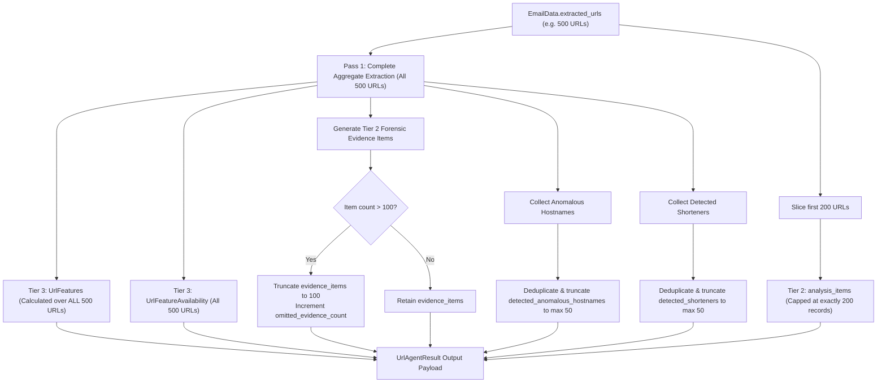

# URL Agent Phase B Implementation Plan

**Document Reference**: `docs/url_agent_phase_b_implementation_plan.md`  
**Authoritative Specifications**:  
- `docs/url_agent_design.md` (Revision v1.10.0)  
- `app/schemas/url_agent_schema.py` (Phase A Pydantic v2 Contract)  
- `tests/test_url_agent_schema.py` (Phase A Schema Verification Suite)  
- `app/schemas/email_schema.py` (Pipeline Shared Ingestion Contract)  
- `app/ingestion/url_extractor.py` (Upstream Ingestion URL Extractor)  
- `app/agents/header_agent.py` (Reference Layer 1 Architectural & Testing Pattern)  

**Component**: Layer 1 Deterministic URL Feature Extraction Agent (`url_agent`)  
**Status**: PLANNING ONLY — Awaiting Review & Explicit Approval  
**Version**: v2.3.0 (Task 9.3.13 Revisions Applied)  
**Date**: November 2026  

---

## Document Change Log

| Version | Date | Author / Context | Key Changes |
|:---:|:---:|:---|:---|
| **v1.0.0** | 2026-11-15 | Task 9.3 Planning | Initial Phase B implementation plan covering module structure, pipeline stages, feature mapping, and testing strategy. |
| **v1.1.0** | 2026-11-15 | Task 9.3.1 Review | Verified `detected_shorteners <= 50` output cap; formalized 8-step deterministic visual anchor detection algorithm; restructured error handling into 4 distinct operational tiers. |
| **v1.2.0** | 2026-11-15 | Task 9.3.2 Review | Reconciled plan to the exact 5-category partition (A: 6, B: 13, C: 8, D: 7, E: 5); restricted visual anchor analysis strictly to `URLSource.HTML_HREF` (excluding `HTML_OTHER`, `HTML_SRC`, `PLAIN_TEXT`, and `HEADER`); specified exact schema-valid top-level error construction with downstream uncomputed feature gating; expanded test suite. |
| **v1.3.0** | 2026-11-15 | Task 9.3.3 Review | Resolved top-level error contract and semantic tension in Section 9.4; analyzed representation of all 3 conditions (zero URLs, successful extraction with URLs, URLs with top-level processing failure); documented Phase A schema contract limitation and trade-offs (in-schema baseline with explicit status gating vs separate error envelope vs future v2.0 schema revision); verified downstream gating status (neither Layer 2 Evidence Aggregator nor Layer 3 Meta-Classifier exists in codebase, establishing gating on `result.status == "error"` as a mandatory future integration requirement); specified top-level exception safety for `email_data.email_id` (raising input contract error when missing/empty, prohibiting synthetic IDs) and safe extraction for `extracted_urls`; expanded Group 11 test cases and acceptance criteria. |
| **v1.4.0** | 2026-11-15 | Task 9.3.4 Review | Corrected URL Agent error-handling architecture: definitively rejected Option A (prohibiting the semantically contradictory combination of `status="error"`, `total_urls_extracted > 0`, and `avail_has_urls=False`); evaluated and adopted a fail-closed error path raising dedicated `UrlAgentProcessingError` on unrecoverable top-level failures; evaluated architectural consequences for `analyze_urls()` and multi-agent pipeline; detailed why a separately approved Phase A v2.0 schema revision is required if future orchestrators demand non-raising result envelopes; established constructor exception safety (handling `email_data=None`, missing/blank `email_id` with zero synthetic IDs, corrupted `extracted_urls`, chained exceptions, safe traceback diagnostics); formalized the 3 operational states; updated test strategy and acceptance criteria. |
| **v1.5.0** | 2026-11-15 | Task 9.3.5 Review | Final error-handling contract corrections: delineated caller input contract violations (`TypeError`, `ValueError`, `AttributeError`) from internal processing failures (`UrlAgentProcessingError`); corrected corrupted `extracted_urls` handling (prohibiting silent conversion of `None`, missing, non-collection, or property access exceptions to zero URLs; requiring verified empty collection for State 1); separated `email_id` validation from preservation (enforcing exact preservation of valid identifiers including boundary whitespace without stripping or silent mutation, matching shared schema); updated 3-state operational table with distinct invalid-input condition; expanded Group 11 test requirements and acceptance criteria. |
| **v1.6.0** | 2026-11-15 | Task 9.3.6 Review | Final entrypoint validation and exception placement: eliminated repeated descriptor access via single-access attribute retrieval (`getattr` without prior `hasattr`), cleanly distinguishing missing attributes (`AttributeError`) from exceptions raised during dynamic property retrieval (which propagate naturally); extended top-level processing error handling to wrap unexpected internal failures during State 1 (`create_no_url_result`) as `UrlAgentProcessingError` with `total_urls_extracted=0` alongside State 2 pipeline crashes, while strictly keeping caller input-contract violations outside the processing try-block; reconciled testing activity record. |
| **v1.7.0** | 2026-11-15 | Task 9.3.7 Review | Final attribute error semantics and extracted URL contract validation: resolved AttributeError ambiguity on single-access retrieval by specifying static non-evaluating attribute detection (`inspect.getattr_static` and model field introspection), distinguishing genuinely missing attributes from descriptor/property getter crashes while preserving original getter exception diagnostics and never invoking getters twice; replaced broad `Collection` check with strict sequence validation (`collections.abc.Sequence` excluding strings, bytes, and mappings) and single-pass element type/structure validation against `ExtractedURL`; ensured genuinely empty collections (`[]`) qualify for State 1 while invalid collections or elements fail-fast with caller input exceptions outside the processing try-block; updated testing specifications, acceptance criteria, and technical clarifications. |
| **v1.8.0** | 2026-11-15 | Task 9.3.8 Review | Final ExtractedURL contract enforcement and attribute introspection hardening: eliminated duck-typing fallback to strictly enforce the upstream ingestion contract (`isinstance(item, ExtractedURL)`), rejecting arbitrary objects, dictionaries, strings, numbers, and unvalidated mocks; completely eliminated repeated element property access during validation (zero property evaluations); formalized the operational distinction between Pass 1 (caller input validation pass) and subsequent pipeline execution passes (Pass 2 per-URL feature extraction, Pass 3 aggregate metrics); streamlined `_get_caller_attribute()` to rely strictly on non-evaluating static inspection (`inspect.getattr_static`) and Python 3.10+ `exc.name` metadata without secondary dynamic lookups; documented exact limitations for custom `__getattr__` and `__getattribute__` implementations; updated testing specifications, acceptance criteria, and technical clarifications. |
| **v1.9.0** | 2026-11-15 | Task 9.3.9 Review | Final caller contract strictness and declared collection enforcement: aligned entrypoint validation strictly with the declared Pydantic ingestion contracts; enforced `isinstance(email_data, EmailData)` at entry, rejecting `None`, dictionaries, strings, numbers, and unrelated classes; enforced `isinstance(raw_urls, list)` for `EmailData.extracted_urls` (matching its declared `list[ExtractedURL]` contract), strictly rejecting tuples, sets, generators, strings, bytes, mappings, and non-list sequences; preserved verified empty-list State 1 behavior; aligned error messages, preconditions, operational state tables, test specifications, and acceptance criteria. |
| **v2.0.0** | 2026-11-15 | Task 9.3.10 Review | Pydantic validation provenance and strict contract test reconciliation: formalized the Pydantic trust model, clarifying that `isinstance(email_data, EmailData)` verifies class inheritance but does not guarantee field validation when bypassed (e.g. via `model_construct()` or post-construction mutation); established the architectural trust boundary where validated upstream ingestion (`email_ingestor.py`) is trusted for non-URL domains while independent defensive validation is strictly enforced for URL Agent inputs (`email_id`, `extracted_urls`); reconciled test strategy with strict `EmailData` enforcement using legitimate `EmailData` subclasses (for property counters and descriptor crash simulations) and `EmailData.model_construct()` (for unvalidated field tests), ensuring test inputs reach the intended validation logic without premature entrypoint failure; updated test specifications and acceptance criteria. |
| **v2.1.0** | 2026-11-15 | Task 9.3.11 Review | ExtractedURL validation provenance and Pydantic-compatible test instrumentation: formalized ExtractedURL validation provenance under Architecture A (trusting upstream extractor's validated `ExtractedURL` instances via explicit trust boundary and DTO immutability assumptions, preserving zero element property accesses in Step 1, and maintaining fail-closed `UrlAgentProcessingError` safety under trust boundary breaches); replaced `@property` subclassing with Pydantic-compatible `__getattribute__` instrumentation (`MonitoredEmailData`, `CrashingEmailData`) that preserves 100% of Pydantic model field definitions, defaults, validators, and construction behavior; separated isolated direct unit tests of `_get_caller_attribute()` on plain Python objects from public `analyze_urls()` contract tests; reconciled comprehensive 8-case test matrix; updated acceptance criteria and clarifications. |
| **v2.2.0** | 2026-11-15 | Task 9.3.12 Review | Complete data-path audit, invalid-field vulnerability analysis, and adoption of Architecture B: audited complete repository data paths; proved that Architecture A trust assumptions are not architecturally guaranteed (`ExtractedURL` is non-frozen, `analyze_urls()` is a public entrypoint, and invalid fields like `source="invalid"` fail silently open rather than triggering processing errors); formally adopted Architecture B (Independent Boundary Validation with Single-Access Field Reuse) to validate `original_url`, `source`, `anchor_text`, and `normalized_url` in Step 1 and cache them in internal records, strictly preserving single-access property evaluation while eliminating secondary descriptor calls in Step 2; formalized 4-tier failure domain classification; justified performance cost (<0.7 ms for 3,134 URLs); updated test requirements, reference implementation, and acceptance criteria. |
| **v2.3.0** | 2026-11-15 | Task 9.3.13 Review | Complete ValidatedURLRecord coverage and elimination of raw-object access: completed comprehensive audit across all 8 fields of `ExtractedURL` (`original_url`, `source`, `anchor_text`, `normalized_url`, `scheme`, `hostname`, `path`, `query`); established authoritative field-usage table distinguishing direct consumption from internal re-parsing; expanded `ValidatedURLRecord` to cache all consumed fields as immutable, typed attributes (`@dataclass(frozen=True, slots=True)`); completely eliminated `raw_item` from `ValidatedURLRecord`, ensuring downstream modules have zero access to unvalidated `ExtractedURL` objects or descriptor properties; corrected Section 8.1 Availability Manifest calculations to read exclusively from `validated_records` (`r.hostname`, `r.anchor_text`, `r.source`), strictly prohibiting element-property reads on `email_data.extracted_urls` after Step 1 while permitting list length usage; labeled the ~0.65 ms boundary validation overhead claim for 3,134 URLs as an unverified theoretical engineering estimate based on standard CPython slot/descriptor lookups rather than an empirical benchmark; updated entrypoint Step 1 validation, Group 11 test specifications, acceptance criteria, and technical clarifications. |

---

## Executive Summary

This document establishes the detailed, comprehensive implementation plan for **Phase B of the URL Agent**. Phase B transitions the URL Agent from its validated Phase A schema contracts into a fully operational, deterministic, passive feature extraction component.

### Core Architectural Invariants
1. **Strictly Passive & Offline Execution**: Zero network requests, zero DNS lookups, zero WHOIS lookups, zero live HTTP fetches, and zero external reputation lookups. All Public Suffix List rules and URL shortener definitions are loaded from local, immutable data files.
2. **Zero Phishing Verdicts or Risk Scores**: Layer 1 agents emit objective measurements, structural indicators, and forensic evidence. They do **not** emit calibrated probabilities, risk categories, confidence scores, or binary phishing classifications.
3. **Canonical Feature Space & Five-Category Partition**: Extracts exactly **39 canonical features** partitioned across the approved **5 categories**:
   - **Category A**: URL Basic & Structural Counts (Features 1–6, count: 6, 5 active, 1 quarantined)
   - **Category B**: Lexical, Path & Host Properties (Features 7–19, count: 13, 13 active)
   - **Category C**: Domain Identity & Hostname Composition (Features 20–27, count: 8, 7 active, 1 quarantined)
   - **Category D**: Obfuscation, Encodings & Shorteners (Features 28–34, count: 7, 7 active)
   - **Category E**: Contextual Alignment & Behavioral Indicators (Features 35–39, count: 5, 4 active, 1 quarantined)
4. **Permanent Feature Quarantines**:
   - **Feature 4 (`http_url_count`)** [Category A]: Evaluates as an active integer count of HTTP URLs across all extracted URLs, but is documented and quarantined from primary ML model training due to historical temporal confounding on 2002 SpamAssassin ham.
   - **Feature 27 (`has_brand_in_path`)** [Category C]: Quarantined (`None`, pending curated brand registry).
   - **Feature 39 (`has_form_action_url`)** [Category E]: Quarantined (`None`, pending HTML form action ingestion support).
5. **Full Aggregate Coverage vs. Output Limits**:
   - Aggregate feature calculations (all 39 features, ratios, and counts) **must and do evaluate across 100% of extracted URLs** in `EmailData.extracted_urls` (even for emails with 500 or 3,134 URLs).
   - The output caps (`analysis_items <= 200`, `evidence_items <= 100`, `detected_anomalous_hostnames <= 50`, `detected_shorteners <= 50`, `observed_anomalies <= 100`) apply **strictly to output containers** and never truncate aggregate feature calculation.
6. **Reproducible IP Classification**: Employs an explicit, version-independent network range hierarchy with longest-prefix exception matching to classify IPv4 and IPv6 addresses into the 9 canonical RFC categories across Python 3.11, 3.12, and 3.13 without relying dynamically on `ip.is_global`.
7. **Strict Anchor Source Qualification**: Restricts visual anchor mismatch analysis strictly to `URLSource.HTML_HREF` (actual `<a href="...">` tags with visible anchor text). Excludes `HTML_OTHER` (`<form action>` and `<link href>`), `HTML_SRC`, `PLAIN_TEXT`, and `HEADER` from anchor mismatch evaluation.
8. **Availability Invariant**: Sets `avail_structure_features = avail_has_urls`, adhering strictly to the Section 10.2 invariant where $C_{\text{struct}} = 1.0$ unconditionally whenever URLs exist.

---

## 1. Inspected Project Sources

Before drafting this plan, the following project components and artifacts were inspected:
1. `docs/url_agent_design.md` (v1.10.0): Authoritative design specification defining pipeline stages, missingness tables, PSL handling, IP classification rules, and Section 10.2 completeness equations.
2. `docs/url_agent_implementation_plan.md` (v1.1.0): High-level multi-phase plan establishing URL processing limits and category partitioning (A: 6, B: 13, C: 8, D: 7, E: 5).
3. `app/schemas/url_agent_schema.py`: Approved Phase A Pydantic v2 data models, containing `UrlAgentResult`, `UrlFeatures`, `UrlFeatureAvailability`, `UrlEvidence`, `UrlEvidenceItem`, `UrlAnalysisItem`, category partition constants, and `is_feature_available()` query logic.
4. `tests/test_url_agent_schema.py`: Approved Phase A unit test suite verifying schema constraints, availability truth tables across 5 scenarios, completeness consistency, and serialization contracts (63 passing tests).
5. `app/schemas/email_schema.py`: Ingestion contracts defining `EmailData`, `EmailHeaders`, `ExtractedURL`, `URLSource` (`PLAIN_TEXT`, `HTML_HREF`, `HTML_SRC`, `HTML_OTHER`, `HEADER`), and `VerificationStatus`.
6. `app/ingestion/url_extractor.py`: Upstream extraction implementation verifying how `URLSource.HTML_HREF` is used exclusively for `<a href>` tags, while `HTML_OTHER` is used for `<form action>` and `<link href>`.
7. `app/agents/header_agent.py` & `tests/test_header_agent.py`: Reference implementations demonstrating Layer 1 error-handling, evidence construction, IP classification, and integration test patterns.

---

## 2. Proposed Architecture & Module Decomposition

### 2.1 Directory & File Layout

Phase B will introduce the following files without modifying existing Phase A schemas or ingestion modules:

```
phishing-detector/
├── app/
│   ├── data/
│   │   ├── public_suffix_list.dat       # Bundled Mozilla PSL snapshot (immutable)
│   │   ├── public_suffix_list.sha256    # SHA-256 integrity verification
│   │   ├── url_shorteners.txt           # Versioned list of known shortener domains
│   │   └── url_shorteners.sha256        # SHA-256 integrity verification
│   └── agents/
│       ├── __init__.py                  # Expose analyze_urls and public helpers
│       ├── url_agent.py                 # Core URL Agent orchestrator & pipeline
│       └── url_components/              # Modular sub-components for clean separation
│           ├── __init__.py
│           ├── ip_classifier.py         # 9-category RFC IP classification engine
│           ├── psl_resolver.py          # Offline trie-based PSL registered domain resolver
│           ├── syntax_validator.py      # Safe parsing & 5-condition malformed URL validator
│           ├── lexical_features.py      # Entropy, percent-encoding, obfuscation, paths
│           └── contextual_analyzer.py   # Anchor mismatch & sender domain alignment
└── tests/
    ├── test_url_agent.py                # Comprehensive Phase B unit & integration tests
    └── test_url_agent_schema.py         # Phase A schema tests (unmodified regression baseline)
```

### 2.2 Component Responsibilities

1. **`app/agents/url_components/ip_classifier.py`**:
   - Implements `classify_ip_address(ip_str: str) -> IPClassificationCategory`.
   - Performs IPv4-mapped IPv6 unwrap (`::ffff:0:0/96`).
   - Evaluates IPv4 longest-prefix overrides in `192.0.0.0/24` (RFC 7723, RFC 8155 -> `syntactically_global`).
   - Evaluates IPv6 longest-prefix overrides in `2001::/23` (7 `syntactically_global` allocations, 3 `special_purpose` allocations, `/23` parent default -> `special_purpose`).
   - Evaluates 14 IPv6 allocations outside `2001::/23` (including `64:ff9b::/96`, `2620:4f:8000::/48`, `100::/64`, `100:0:0:1::/64`, `3fff::/20`, `5f00::/16`).
   - Handles IPv6 Multicast (`ff00::/8`) under RFC 4291 / IANA IPv6 Address Space independently of special-purpose unicast registry.
   - Prevents `2000::/3` global unicast fallback misclassifications by matching documentation and special-purpose ranges first.

2. **`app/agents/url_components/psl_resolver.py`**:
   - Loads and parses `app/data/public_suffix_list.dat` into a fast, in-memory trie structure upon first import or initialization.
   - Implements `resolve_domain(hostname: Optional[str]) -> tuple[Optional[str], DomainResolutionStatus, int]`:
     - Returns `(registered_domain, status, subdomain_depth)`.
     - Supports `EXACT_MATCH`, `WILDCARD_MATCH` (`*.ck`), `EXCEPTION_MATCH` (`!www.ck`), `UNKNOWN_SUFFIX`, `INVALID_HOSTNAME`, `IP_LITERAL`, and `NO_HOSTNAME`.
     - Bounded subdomain depth computation: count of dot-separated labels preceding the effective PSL registered domain.
   - Fallback policy for unknown suffixes: `registered_domain = None`, status = `UNKNOWN_SUFFIX`. (No speculative right-splitting).

3. **`app/agents/url_components/syntax_validator.py`**:
   - Implements `validate_url_syntax(url_str: str) -> tuple[bool, list[str]]`.
   - Safely parses arbitrary URL strings using `urllib.parse.urlsplit` wrapped in exception handling.
   - Checks the 5 distinct failure conditions for Feature 30 (`malformed_url_count`):
     1. `urlsplit` raises an unhandled exception (e.g., unclosed IPv6 brackets).
     2. Accessing `.port` raises a `ValueError` (non-numeric port or out of range `> 65535`).
     3. Port is integer `0` (outside valid TCP range 1–65535).
     4. Missing authority/netloc for web schemes (`http://`, `https://`).
     5. Malformed percent-escape (`%` not followed by two hex digits).
   - Enforces the **single bounded increment guarantee**: each URL increments `malformed_url_count` by at most 1, while recording all distinct reasons in Tier 2 evidence.

4. **`app/agents/url_components/lexical_features.py`**:
   - Calculates character-level metrics: `url_length`, `max_path_depth`, `has_executable_file_in_path`.
   - Implements Shannon entropy: $H(s) = -\sum p_i \log_2 p_i$ on hostnames.
   - Detects percent-encoding triplets (`%[0-9a-fA-F]{2}`) and double-encoding (`%25[0-9a-fA-F]{2}`).
   - Detects credentials (`user:pass@`) and `@` symbol deception preceding the host.
   - Detects unusual IP formats (hexadecimal `0x7f...`, octal `0177...`, integer notation).
   - Implements two-pronged Punycode detection:
     - *Prong 1*: `xn--` in normalized hostname labels.
     - *Prong 2*: `ord(c) > 127` in raw hostname from `original_url` (path/query non-ASCII excluded).
   - Detects non-ASCII characters across the full URL (Feature 28).

5. **`app/agents/url_components/contextual_analyzer.py`**:
   - Implements offline URL shortener detection using `app/data/url_shorteners.txt` (`frozenset[str]`).
   - Implements open redirect parameter detection across query keys (`url=`, `redirect=`, `dest=`, `target=`, `goto=`, `r=`, `link=`, `destination=`, `return=`, `next=`).
   - Implements visual anchor text mismatch evaluation (Features 34 & 35) following the strict source qualification (`HTML_HREF` only) and deterministic procedure in Section 6.2.
   - Implements From header sender-domain alignment (Features 36, 37, 38):
     - Extracts and PSL-resolves sender domain from `EmailHeaders.from_address`.
     - Calculates $N_{\text{resolvable}}$ across all extracted URLs whose status is in `{EXACT_MATCH, WILDCARD_MATCH, EXCEPTION_MATCH}`.
     - Calculates $N_{\text{match}}$ where target PSL registered domain equals From PSL registered domain.
     - Evaluates `sender_domain_matching_url_ratio = N_match / N_resolvable`.
     - Evaluates `external_link_ratio = (N_resolvable - N_match) / N_resolvable = 1.0 - ratio`.
     - Evaluates `has_sender_domain_mismatch_url = (N_match < N_resolvable)`.
     - Correctly sets all three features to `None` when preconditions are unmet.

6. **`app/agents/url_agent.py` (Core Pipeline Coordinator)**:
   - Exposes public entry-point: `analyze_urls(email_data: EmailData) -> UrlAgentResult`.
   - Orchestrates the 7-stage deterministic processing pipeline:
     - Stage 1: Input Validation & No-URL check.
     - Stage 2: Per-URL analysis (`UrlAnalysisItem`) for the first 200 URLs.
     - Stage 3: Full aggregate feature extraction across all extracted URLs.
     - Stage 4: Tier 2 forensic evidence collection and capping (`max 100`).
     - Stage 5: Anomalous hostname collection (`max 50`) and shortener collection (`max 50`).
     - Stage 6: Availability manifest and Section 10.2 completeness validation.
     - Stage 7: Payload construction and schema validation.

---

## 3. Detailed Feature-by-Feature Implementation Mapping (All 39 Features, 5 Categories)

The 39 canonical features are partitioned across the approved **five categories** (A: 6, B: 13, C: 8, D: 7, E: 5):

| # | Exact Feature Name | Category | Type | Status | Calculation Method | Input Fields Required | Missingness Behavior |
|:---:|:---|:---:|:---:|:---:|:---|:---|:---|
| **1** | `total_url_count` | Category A | `int` | **Active** | Validated URL count ($N$). | Validated list length ($N$) | `0` if no URLs. |
| **2** | `unique_url_count` | Category A | `int` | **Active** | Count of distinct normalized URLs across all URLs. Identity key: `r.normalized_url.strip()` if present, else `r.original_url.strip()`. | `ValidatedURLRecord.normalized_url`, `ValidatedURLRecord.original_url` | `0` if no URLs. |
| **3** | `has_urls` | Category A | `bool` | **Active** | `total_url_count > 0` | `total_url_count` | `False` if no URLs. |
| **4** | `http_url_count` | Category A | `int` | **Quarantined** | Exact count of URLs where scheme is `'http'`. Evaluated as an integer measurement across all URLs, but quarantined from downstream ML models due to 2002 ham temporal confounding. | `ValidatedURLRecord.scheme` or parsed scheme | `0` if no URLs. |
| **5** | `https_url_count` | Category A | `int` | **Active** | Exact count of URLs where scheme is `'https'`. | `ValidatedURLRecord.scheme` or parsed scheme | `0` if no URLs. |
| **6** | `suspicious_scheme_count` | Category A | `int` | **Active** | Count of URLs with scheme in `{'javascript', 'data', 'file', 'vbscript', 'callto'}`. | `ValidatedURLRecord.scheme` or parsed scheme | `0` if no URLs. |
| **7** | `has_suspicious_scheme` | Category B | `bool` | **Active** | `suspicious_scheme_count > 0` | `suspicious_scheme_count` | `False` if no URLs. |
| **8** | `has_non_default_port` | Category B | `bool` | **Active** | True if any URL specifies an explicit port other than standard defaults (HTTP 80, HTTPS 443, FTP 21, SSH 22). | Parsed port and scheme | `False` if no URLs. |
| **9** | `max_url_length` | Category B | `int` | **Active** | `max(len(r.original_url) for r in validated_records)` | `ValidatedURLRecord.original_url` | `0` if no URLs. |
| **10** | `max_path_depth` | Category B | `int` | **Active** | `max(count_path_segments(r.path) for r in validated_records)` (excluding leading/trailing slashes). | `ValidatedURLRecord.path` or parsed path | `0` if no URLs. |
| **11** | `has_executable_file_in_path` | Category B | `bool` | **Active** | True if path terminates with `.exe`, `.scr`, `.bat`, `.vbs`, `.cpl`, `.msi`, `.apk`, `.cmd` (case-insensitive). | Parsed URL path | `False` if no URLs. |
| **12** | `has_ip_literal_url` | Category B | `bool` | **Active** | True if any URL hostname parses as an IPv4 or IPv6 address literal via `ipaddress.ip_address()`. | Hostname component | `False` if no URLs. |
| **13** | `has_private_ip_url` | Category B | `bool` | **Active** | True if any URL hostname is classified as `rfc1918` or `rfc4193` (including unwrapped IPv4-mapped IPv6). Link-local excluded. | Classified IP category | `False` if no URLs. |
| **14** | `has_loopback_ip_url` | Category B | `bool` | **Active** | True if any URL hostname is classified as `loopback` (`127.0.0.1`, `::1`, or `::ffff:127.0.0.1`). | Classified IP category | `False` if no URLs. |
| **15** | `has_special_ip_url` | Category B | `bool` | **Active** | True if any URL hostname is classified as `cgnat`, `documentation`, `multicast`, or `special_purpose`. Link-local excluded. | Classified IP category | `False` if no URLs. |
| **16** | `has_punycode_url` | Category B | `bool` | **Active** | True if any hostname has label starting with `xn--` (Prong 1) OR raw hostname has char with `ord(c) > 127` (Prong 2). Path/query non-ASCII excluded. | Normalized hostname & raw hostname | `False` if no URLs. |
| **17** | `max_subdomain_depth` | Category B | `int` | **Active** | Maximum number of dot-separated labels preceding the PSL registered domain for resolvable domains (`EXACT_MATCH`, `WILDCARD_MATCH`, `EXCEPTION_MATCH`). | Hostname & registered domain | `0` if no URLs or no resolvable domains. |
| **18** | `has_excessive_subdomains` | Category B | `bool` | **Active** | `max_subdomain_depth >= 3` | `max_subdomain_depth` | `False` if no URLs. |
| **19** | `max_hostname_entropy` | Category B | `Optional[float]` | **Active** | Maximum Shannon entropy $-\sum p_i \log_2 p_i$ across all non-empty hostnames. | Hostnames across all URLs | `None` if no URLs or hostnames missing. |
| **20** | `unique_domain_count` | Category C | `int` | **Active** | Count of distinct heterogeneous domain identities: PSL registered domain for resolvable, canonical IP for IP literals, full FQDN for unknown suffixes. | All extracted URLs | `0` if no URLs. |
| **21** | `unique_fqdn_count` | Category C | `int` | **Active** | Count of distinct lowercased FQDN hostnames. IP literals and URLs without hostnames are excluded. | Hostnames across all URLs | `0` if no URLs. |
| **22** | `has_at_symbol_in_url` | Category C | `bool` | **Active** | True if authority segment contains `@` preceding the host. | Parsed netloc / authority | `False` if no URLs. |
| **23** | `has_embedded_credentials` | Category C | `bool` | **Active** | True if authority segment explicitly embeds user credentials (`username:password@`). | Parsed netloc / userinfo | `False` if no URLs. |
| **24** | `has_percent_encoding` | Category C | `bool` | **Active** | True if URL contains valid percent-encoded triplets (`%[0-9a-fA-F]{2}`). | Raw URL string | `False` if no URLs. |
| **25** | `has_double_percent_encoding` | Category C | `bool` | **Active** | True if URL contains double percent-encoding: `%25[0-9a-fA-F]{2}`. | Raw URL string | `False` if no URLs. |
| **26** | `max_percent_encoded_count` | Category C | `int` | **Active** | Maximum count of percent-encoded triplets (`%xx`) in a single URL across all extracted URLs. | Raw URL strings | `0` if no URLs. |
| **27** | `has_brand_in_path` | Category C | `Optional[bool]` | **Quarantined** | Permanently `None`. Quarantined pending curated brand registry and validation heuristics. | None | Permanently `None`. |
| **28** | `has_non_ascii_url` | Category D | `bool` | **Active** | True if `original_url` contains any character outside ASCII 32–126. | `ExtractedURL.original_url` | `False` if no URLs. |
| **29** | `has_unusual_ip_format` | Category D | `bool` | **Active** | True if authority/host contains IP in hexadecimal (`0x7f.1`), octal (`0177.0.0.1`), or integer notation (`2130706433`). | Raw authority/netloc | `False` if no URLs. |
| **30** | `malformed_url_count` | Category D | `int` | **Active** | Count of URLs failing structural syntax validation across 5 failure conditions (Section 5.7). Single bounded increment guarantee. | `ExtractedURL.original_url` | `0` if no URLs. |
| **31** | `has_url_shortener` | Category D | `bool` | **Active** | True if any URL domain/hostname matches the offline versioned shortener registry. | Hostnames & registered domains | `False` if no URLs. |
| **32** | `url_shortener_count` | Category D | `int` | **Active** | Total count of URL occurrences matching the offline shortener registry. | Hostnames & registered domains | `0` if no URLs. |
| **33** | `has_redirect_parameter` | Category D | `bool` | **Active** | True if query string contains known redirect parameter keys (`url=`, `redirect=`, `dest=`, `target=`, `goto=`, etc.). | Parsed query strings | `False` if no URLs. |
| **34** | `has_anchor_url_mismatch` | Category D | `bool` | **Active** | True if visible anchor text displays a URL/domain whose PSL domain (or FQDN) mismatches the href target domain. Requires `source == HTML_HREF`. | `ExtractedURL.anchor_text`, target domain | `False` if no URLs or no anchor tags. |
| **35** | `anchor_url_mismatch_count` | Category E | `int` | **Active** | Count of HTML hyperlinks displaying deceptive anchor text. Requires `source == HTML_HREF`. | `ExtractedURL.anchor_text`, target domain | `0` if no URLs or no anchor tags. |
| **36** | `has_sender_domain_mismatch_url` | Category E | `Optional[bool]` | **Active** | `True` if $N_{\text{match}} < N_{\text{resolvable}}$; `False` if $N_{\text{match}} == N_{\text{resolvable}}$; `None` if $N_{\text{resolvable}} == 0$ or From domain unresolvable. | `headers.from_address`, target registered domains | `None` if preconditions unmet. |
| **37** | `sender_domain_matching_url_ratio` | Category E | `Optional[float]` | **Active** | $N_{\text{match}} / N_{\text{resolvable}}$ across all extracted URL occurrences. Range [0.0, 1.0]. | `headers.from_address`, target registered domains | `None` if preconditions unmet. |
| **38** | `external_link_ratio` | Category E | `Optional[float]` | **Active** | $(N_{\text{resolvable}} - N_{\text{match}}) / N_{\text{resolvable}} = 1.0 - \text{matching\_ratio}$. Range [0.0, 1.0]. | `headers.from_address`, target registered domains | `None` if preconditions unmet. |
| **39** | `has_form_action_url` | Category E | `Optional[bool]` | **Quarantined** | Permanently `None`. Quarantined due to `URLSource.HTML_OTHER` ingestion conflation. | None | Permanently `None`. |

---

## 4. URL Parsing, Normalization, and Syntax Validation

### 4.1 Safe Parsing of Malformed URLs
Every URL string in `EmailData.extracted_urls` is evaluated using `urllib.parse.urlsplit` wrapped inside defensive exception handlers. Hostile inputs (e.g. unclosed IPv6 brackets `http://[::1/path`, thousands of `%` characters, or non-numeric port strings `:abc`) must never raise unhandled exceptions.

### 4.2 Five Malformed URL Conditions (Feature 30)
`validate_url_syntax(url_str: str) -> tuple[bool, list[str]]` checks:
1. **Parser Exception**: `urlsplit(url_str)` raises `ValueError` or standard parser crash.
2. **Malformed Port Property**: Accessing `split_res.port` raises `ValueError` (e.g. `http://example.com:abc/` or `http://example.com:99999/`).
3. **Port 0**: `split_res.port == 0` (port 0 is invalid for TCP/UDP web traffic).
4. **Missing Web Authority**: Scheme is `http` or `https`, but `split_res.netloc` is empty or missing (e.g. `http:///path`).
5. **Malformed Percent Escapes**: The URL string contains a `%` character that is not followed by exactly two hexadecimal characters (e.g. `%GG`, `%2`, or trailing `%`).

**Single Bounded Increment Guarantee**: If a URL triggers both Condition 2 and Condition 5 (e.g. `http://example.com:99999/%GG/path`), `malformed_url_count` increments by **exactly 1**. Both reasons are recorded in `malformed_reasons` for Tier 2 evidence.

### 4.3 Hostname Normalization & IDNA Handling
- Hostnames are extracted, stripped of trailing dots and whitespace, and lowercased.
- Internationalized domain names (IDN) are normalized to ASCII Punycode using Python's standard `raw_host.encode("idna").decode("ascii")` inside a safe try-except block.
- If IDNA encoding raises an exception (e.g. invalid label characters), the raw lowercased hostname is preserved.

### 4.4 Domain Resolution Status Assignment
The resolver evaluates each extracted URL and assigns exactly one of the 7 approved enum values from `DomainResolutionStatus`:
1. `NO_HOSTNAME`: The URL scheme has no hostname authority (e.g. `data:`, `javascript:`, `file:`, `mailto:`).
2. `INVALID_HOSTNAME`: Hostname is present but fails structural validation (empty, whitespace-only, contains invalid characters).
3. `IP_LITERAL`: Hostname successfully parses as an IPv4 or IPv6 address literal via `ipaddress.ip_address()`.
4. `EXCEPTION_MATCH`: Hostname matches an exception rule in the PSL snapshot (e.g. `!www.ck`).
5. `WILDCARD_MATCH`: Hostname matches a wildcard rule in the PSL snapshot (e.g. `*.ck`).
6. `EXACT_MATCH`: Hostname matches an explicit rule in the PSL snapshot (e.g. `co.uk`, `com`).
7. `UNKNOWN_SUFFIX`: Hostname has valid structure, but its public suffix is not present in the bundled PSL snapshot. `registered_domain` evaluates to `None` (no speculative right-splitting).

---

## 5. Domain and IP Analysis

### 5.1 Public Suffix List (PSL) Offline Resolution
- Bundled snapshot: `app/data/public_suffix_list.dat` (Mozilla MPL-2.0, version tagged `PSL-Snapshot-2026-11`).
- Companion SHA-256 hash verified during startup/testing.
- Fast in-memory label trie maps reverse domain labels:
  - Exact match: `["uk", "co"]`
  - Wildcard match: `["ck", "*"]`
  - Exception match: `["ck", "!www"]`
- Resolution extracts:
  - `registered_domain`: The effective public suffix plus one preceding private label.
  - `subdomain_depth`: Count of labels preceding the registered domain. Example: `a.b.c.example.com` has PSL registered domain `example.com` and 3 subdomain labels (`a`, `b`, `c`), giving depth `3`.

### 5.2 Heterogeneous Unique Domain Counting Rules (Feature 20)
`unique_domain_count` maintains a deduplication set constructed from three distinct sources across all extracted URLs:
1. **PSL Registered Domains**: For URLs with status `EXACT_MATCH`, `WILDCARD_MATCH`, `EXCEPTION_MATCH`, the identity key is the lowercased registered domain (e.g. `paypal.com`).
2. **Canonical IP Strings**: For URLs with status `IP_LITERAL`, the identity key is the canonical string `str(ipaddress.ip_address(host))` (e.g. `192.168.1.1`).
3. **Full FQDNs for Unknown Suffixes**: For URLs with status `UNKNOWN_SUFFIX` (e.g. `.internal`, `.corp`), the identity key is the full lowercased FQDN (e.g. `wiki.corp.internal`).
4. **Excluded**: URLs with `INVALID_HOSTNAME` or `NO_HOSTNAME` are excluded from domain counting.

### 5.3 Deterministic IP Address Classification
Implemented via `classify_ip_address(ip_str: str) -> IPClassificationCategory` using explicit network ranges:

1. **IPv4-Mapped IPv6 Unwrap**: If `ip` is IPv6 and `ip.ipv4_mapped` is present (`::ffff:0:0/96`), unwrapped to IPv4 before precedence evaluation.
2. **IPv4 Precedence Order**:
   - *Precedence 1*: More-specific global overrides: `192.0.0.9/32` (PCP Anycast), `192.0.0.10/32` (TURN Anycast) -> `syntactically_global`.
   - *Precedence 2*: Loopback `127.0.0.0/8` -> `loopback`.
   - *Precedence 3*: Link-Local `169.254.0.0/16` -> `link_local`.
   - *Precedence 4*: Multicast `224.0.0.0/4` -> `multicast`.
   - *Precedence 5*: CGNAT `100.64.0.0/10` -> `cgnat`.
   - *Precedence 6*: Documentation `192.0.2.0/24`, `198.51.100.0/24`, `203.0.113.0/24` -> `documentation`.
   - *Precedence 7*: Special-Purpose `0.0.0.0/8`, `192.0.0.0/24`, `192.88.99.0/24`, `198.18.0.0/15`, `240.0.0.0/4` -> `special_purpose`.
   - *Precedence 8*: RFC 1918 Private `10.0.0.0/8`, `172.16.0.0/12`, `192.168.0.0/16` -> `rfc1918`.
   - *Precedence 9*: Fallback -> `syntactically_global`.
3. **IPv6 Precedence Order**:
   - *Precedence 1*: Loopback `::1/128` -> `loopback`.
   - *Precedence 2*: Link-Local `fe80::/10` -> `link_local`.
   - *Precedence 3*: Multicast `ff00::/8` (RFC 4291 / IANA IPv6 Address Space) -> `multicast`.
   - *Precedence 4*: Documentation `2001:db8::/32`, `3fff::/20` -> `documentation`.
   - *Precedence 5*: `2001::/23` Longest-Prefix Matching:
     - 7 Global Overrides: `2001:1::1/128`, `2001:1::2/128`, `2001:1::3/128`, `2001:3::/32`, `2001:4:112::/48`, `2001:20::/28`, `2001:30::/28` -> `syntactically_global`.
     - 3 Special Overrides: `2001::/32` (TEREDO, IANA N/A), `2001:2::/48` (Benchmarking, IANA False), `2001:10::/28` (Deprecated, IANA Blank) -> `special_purpose`.
     - `2001::/23` parent prefix default -> `special_purpose`.
   - *Precedence 6*: Special-Purpose: `::/128`, `64:ff9b:1::/48`, `100::/64`, `100:0:0:1::/64`, `2002::/16` (6to4, IANA N/A), `5f00::/16` (SRv6) -> `special_purpose`.
   - *Precedence 7*: Explicit Global Allocations: `64:ff9b::/96`, `2620:4f:8000::/48` -> `syntactically_global`.
   - *Precedence 8*: RFC 4193 ULA `fc00::/7` -> `rfc4193`.
   - *Precedence 9*: `2000::/3` Global Unicast Block Fallback -> `syntactically_global`.
   - *Precedence 10*: Unallocated/Reserved Fallback -> `special_purpose`.

### 5.4 Offline URL Shortener Detection (Features 31 & 32)
- Bundled list: `app/data/url_shorteners.txt` (version tag `SHORTENER-REGISTRY-v1-2026-11`, verified by `.sha256`).
- Loaded into `frozenset[str]`.
- Checks whether `registered_domain in shortener_set` or `hostname in shortener_set`.
- If matched: increments `url_shortener_count`, sets `has_url_shortener = True`, and collects shortener in `detected_shorteners` (capped at 50 per Section 7.2).

---

## 6. Sender and Anchor-Text Analysis

### 6.1 Sender Domain Alignment (Features 36, 37, 38)
1. **Sender Domain Extraction**:
   - Parses `email_data.headers.from_address` using `email.utils.parseaddr`.
   - Extracts hostname from email address (portion following `@`).
   - Resolves sender domain via PSL. If sender hostname is missing, invalid, or produces status outside `{EXACT_MATCH, WILDCARD_MATCH, EXCEPTION_MATCH}`, sender domain is unresolvable.
2. **Occurrence-Based URL Counting**:
   - $N_{\text{resolvable}}$: Count of all extracted URL occurrences whose `DomainResolutionStatus` is in `{EXACT_MATCH, WILDCARD_MATCH, EXCEPTION_MATCH}`.
   - $N_{\text{match}}$: Count of all extracted URL occurrences within $N_{\text{resolvable}}$ whose registered domain matches From registered domain (case-insensitive).
   - URLs with `UNKNOWN_SUFFIX`, `IP_LITERAL`, `INVALID_HOSTNAME`, or `NO_HOSTNAME` are excluded from both $N_{\text{resolvable}}$ and $N_{\text{match}}$.
3. **Exact Mathematical Formulas**:
   $$\text{sender\_domain\_matching\_url\_ratio} = \begin{cases} 
   \text{None}, & \text{if } N_{\text{resolvable}} = 0 \lor \text{from\_domain is unresolvable} \\
   \frac{N_{\text{match}}}{N_{\text{resolvable}}}, & \text{if } N_{\text{resolvable}} > 0 \land \text{from\_domain is resolvable}
   \end{cases}$$
   $$\text{external\_link\_ratio} = \begin{cases} 
   \text{None}, & \text{if } \text{sender\_domain\_matching\_url\_ratio is None} \\
   1.0 - \text{sender\_domain\_matching\_url\_ratio}, & \text{otherwise}
   \end{cases}$$
   $$\text{has\_sender\_domain\_mismatch\_url} = \begin{cases} 
   \text{None}, & \text{if } N_{\text{resolvable}} = 0 \lor \text{from\_domain is unresolvable} \\
   \mathbf{True}, & \text{if } N_{\text{match}} < N_{\text{resolvable}} \\
   \mathbf{False}, & \text{if } N_{\text{match}} = N_{\text{resolvable}}
   \end{cases}$$
   *(Note: Enforces Pydantic invariant `matching_ratio + external_link_ratio == 1.0` and co-presence).*

### 6.2 Deterministic Visual Anchor-Text URL Detection & Source Qualification (Features 34 & 35)

The approved design specification (Sections 5.4, 8.2, 11.1, and 12 Test Group 13) requires detecting deceptive HTML hyperlinks where the visible anchor text displays a URL or domain whose effective identity mismatches the underlying `href` destination.

#### Step 1: Strict Source Qualification & Preconditions
In accordance with the ingestion pipeline contract (`app/schemas/email_schema.py` and `app/ingestion/url_extractor.py`), URL extraction sources are strictly differentiated:
- **`URLSource.HTML_HREF`**: **The ONLY supported source for anchor-text analysis.** In the ingestion pipeline, this source is emitted exclusively for `<a href="...">` tags where visible link text or nested image alt text is extracted.
- **`URLSource.HTML_OTHER`**: Emitted by ingestion for `<form action="...">` and `<link href="...">`. Conflates form actions with metadata links. **Must NOT be treated as an anchor hyperlink**, even if `anchor_text` happens to be populated.
- **`URLSource.HTML_SRC`**: Emitted for embedded media (``, `<iframe>`, `<script>`). Excluded.
- **`URLSource.PLAIN_TEXT`**: Emitted for unlinked text. Excluded.
- **`URLSource.HEADER`**: Emitted for email headers. Excluded.

*Rule*: A URL record qualifies for visual anchor analysis **if and only if** `rec.source == URLSource.HTML_HREF` AND `rec.anchor_text` is non-empty after stripping surrounding whitespace and delimiters (`<([{"'` and `'>)]}"'`).

#### Step 2: Deterministic Classification of Anchor Text Representation
An anchor string is evaluated to determine whether it visibly presents a web address or domain name rather than natural language descriptive text:
1. **Explicit URL Scheme**: Starts with `http://` or `https://` (case-insensitive).
2. **Explicit Web Prefix**: Starts with `www.` (case-insensitive).
3. **Domain Name Syntax**: Matches the standard syntactic form of a host:
   - Contains **no whitespace** or control characters.
   - Contains at least two dot-separated labels (e.g. `paypal.com`, `login.bank.co.uk`, `update.internal.corp`).
   - The rightmost label (TLD candidate) contains only ASCII alphabetic characters and has a length $\ge 2$.
   - Label characters are restricted to `[a-zA-Z0-9-]` (no commas, exclamation marks, or sentence punctuation).
4. **IP Literal Syntax**: Matches an IPv4 dotted-quad or bracketed IPv6 address literal.

*Rule for Natural Language Anchor Text*: If the anchor text does not meet any of these criteria (e.g. `"Click here"`, `"Log in to your account"`, `"View Invoice"`, `"https"`, `"Download now"`), it is classified as descriptive text $\to$ anchor mismatch is **not evaluated** (`has_anchor_mismatch = False`).

#### Step 3: Displayed Hostname Extraction
- If the anchor string contains an explicit scheme (`http://` or `https://`), parse via `urllib.parse.urlsplit(anchor_text).hostname`.
- If scheme-less (e.g. `www.paypal.com/login` or `paypal.com`), prepend `http://` and extract hostname via `urllib.parse.urlsplit`.
- If `urlsplit` raises an exception or produces `None`, the anchor text fails hostname extraction $\to$ treated as ambiguous; **do not fabricate a mismatch** (`has_anchor_mismatch = False`).

#### Step 4: Displayed Hostname Normalization
- Strip trailing dots and port specifications from the extracted anchor host.
- Lowercase the hostname.
- Apply standard IDNA Punycode normalization (`host.encode("idna").decode("ascii")`) if non-ASCII characters are present.

#### Step 5: Dual Domain Resolution
- Resolve the displayed anchor hostname via the bundled PSL resolver:
  - Produces `anchor_status: DomainResolutionStatus` and `anchor_registered_domain: Optional[str]`.
- The target destination URL already has `dest_status` and `dest_registered_domain` computed in Stage 2.

#### Step 6: Identity Comparison Hierarchy (Design Section 8.2)
1. **Both Domains Resolvable** (`anchor_status` and `dest_status` are both in `{EXACT_MATCH, WILDCARD_MATCH, EXCEPTION_MATCH}`):
   - Compare `anchor_registered_domain.lower() == dest_registered_domain.lower()`.
   - If equal $\to$ **Match** (`has_anchor_mismatch = False`).
   - If unequal $\to$ **Mismatch** (`has_anchor_mismatch = True`).
2. **Unknown Suffix Fallback** (Either or both have `DomainResolutionStatus.UNKNOWN_SUFFIX`):
   - Fall back to case-insensitive full FQDN comparison: `anchor_host.lower() == dest_host.lower()`.
   - If equal $\to$ **Match** (`has_anchor_mismatch = False`).
   - If unequal $\to$ **Mismatch** (`has_anchor_mismatch = True`).
3. **IP Literal Comparison** (`IP_LITERAL`):
   - If both are IP literals: compare canonical IP strings (`str(ipaddress.ip_address(...))`).
   - If one is an IP literal and the other is a domain name $\to$ **Mismatch** (`has_anchor_mismatch = True`).
4. **Invalid or Ambiguous Anchor Hostname** (`anchor_status` in `{INVALID_HOSTNAME, NO_HOSTNAME}`):
   - The anchor string could not be resolved to a valid domain or host identity $\to$ **do NOT fabricate a mismatch** (`has_anchor_mismatch = False`).

#### Step 7: Output Accounting and Evidence Trace
- For each URL where `has_anchor_mismatch == True`:
  - Per-URL: `UrlAnalysisItem.has_anchor_mismatch = True`.
  - Aggregate: `UrlFeatures.has_anchor_url_mismatch = True` (Feature 34, Category D) and `UrlFeatures.anchor_url_mismatch_count += 1` (Feature 35, Category E).
  - Tier 2 Evidence: Generates a Category D `UrlEvidenceItem`:
    - `feature_name = "has_anchor_url_mismatch"`
    - `category = "Category D"`
    - `observed_value = f"text: '{anchor_snippet}' -> href: '{dest_snippet}'"`
    - `description = "Visible anchor text displays a domain that mismatches the actual target destination."`
    - `limitations_and_benign_explanations = "Legitimate corporate newsletters and ESPs (SendGrid, Mailchimp) routinely rewrite anchor links for engagement tracking."`

#### Step 8: Comprehensive Test Cases Matrix (Including Source Qualification)

| Test Case Type | URL Source (`rec.source`) | Anchor Text (`rec.anchor_text`) | Destination URL (`rec.original_url`) | Expected Resolution & Outcome |
|:---|:---:|:---|:---|:---|
| **Positive (Mismatch)** | `HTML_HREF` | `https://paypal.com/login` | `https://evil-phish.com/signin` | `anchor='paypal.com'`, `dest='evil-phish.com'` $\to$ **Mismatch (`True`)** |
| **Positive (Mismatch)** | `HTML_HREF` | `www.chase.com` | `https://chase-security-update.com` | `anchor='chase.com'`, `dest='chase-security-update.com'` $\to$ **Mismatch (`True`)** |
| **Positive (Mismatch)** | `HTML_HREF` | `mybank.com` | `http://192.168.1.1/login` | Domain vs IP literal $\to$ **Mismatch (`True`)** |
| **Positive (Mismatch FQDN)** | `HTML_HREF` | `auth.corp.internal` | `http://auth.corp.external` | Both `UNKNOWN_SUFFIX`, FQDNs differ $\to$ **Mismatch (`True`)** |
| **Negative (Clean Match)** | `HTML_HREF` | `https://paypal.com` | `https://paypal.com/signin` | Same PSL domain `paypal.com` $\to$ **Match (`False`)** |
| **Negative (Subdomain Match)**| `HTML_HREF` | `login.paypal.com` | `https://security.paypal.com/auth` | Same PSL domain `paypal.com` $\to$ **Match (`False`)** |
| **Negative (Unknown Suffix)** | `HTML_HREF` | `wiki.corp.internal` | `https://wiki.corp.internal/index` | Same FQDN $\to$ **Match (`False`)** |
| **Negative (IP Match)** | `HTML_HREF` | `192.168.1.1` | `http://192.168.1.1:8080/` | Same canonical IP $\to$ **Match (`False`)** |
| **Negative (Descriptive Text)**| `HTML_HREF` | `Click Here to Verify` | `https://evil.com/` | Natural language text, not a domain $\to$ **No Mismatch (`False`)** |
| **Negative (Descriptive Text)**| `HTML_HREF` | `Download Invoice #1042` | `https://company.com/inv.pdf` | Natural language text, not a domain $\to$ **No Mismatch (`False`)** |
| **Source Disqualification** | `HTML_OTHER` | `https://paypal.com` | `https://evil.com/action` | `HTML_OTHER` (`<form action>`) is NOT an anchor $\to$ **Excluded (`False`)** |
| **Source Disqualification** | `HTML_SRC` | `https://paypal.com` | `https://evil.com/pixel.gif` | `HTML_SRC` (``) is NOT an anchor $\to$ **Excluded (`False`)** |
| **Source Disqualification** | `PLAIN_TEXT` | `https://paypal.com` | `https://evil.com/text` | `PLAIN_TEXT` is NOT an anchor hyperlink $\to$ **Excluded (`False`)** |
| **Ambiguous (Email Address)** | `HTML_HREF` | `support@paypal.com` | `https://paypal.com/help` | Email address syntax, not a web URL $\to$ **No Mismatch (`False`)** |
| **Ambiguous (Version String)** | `HTML_HREF` | `Release v2.1.0 available` | `https://github.com/repo` | Semantic version string with dots $\to$ **No Mismatch (`False`)** |
| **Ambiguous (Punctuation)** | `HTML_HREF` | `...` or `[More]` | `https://example.com/` | Punctuation / symbols $\to$ **No Mismatch (`False`)** |
| **Ambiguous (Incomplete URL)** | `HTML_HREF` | `https://` or `http://` | `https://example.com/` | Incomplete scheme with no host $\to$ **No Mismatch (`False`)** |

---

## 7. Aggregation, Processing Caps, and Output Limits

### 7.1 Separation of Aggregation and Output Caps



### 7.2 Verification and Authoritative Grounding of Output Limits

The output limits enforced during Phase B are explicitly defined and mandated by the approved design and Phase A Pydantic contracts:

1. **Per-URL Detailed Analysis Cap (`analysis_items <= 200`)**:
   - *Design Source*: `docs/url_agent_design.md` Section 7.2 (line 755), Section 9 (line 837).
   - *Schema Source*: `app/schemas/url_agent_schema.py` line 908 (`analysis_items: list[UrlAnalysisItem] = Field(max_length=200)`).
   - *Behavior*: Detailed inspection records are generated for the first 200 URLs (`validated_records[:200]`). If $N > 200$, a diagnostic warning is appended to `UrlAgentResult.warnings`.
2. **Forensic Evidence Cap (`evidence.evidence_items <= 100`)**:
   - *Design Source*: `docs/url_agent_design.md` Section 6.2 (line 673).
   - *Schema Source*: `app/schemas/url_agent_schema.py` line 790 (`evidence_items: list[UrlEvidenceItem] = Field(max_length=100)`).
   - *Behavior*: First 100 items retained; excess items increment `omitted_evidence_count`.
3. **Anomalous Hostnames Cap (`evidence.detected_anomalous_hostnames <= 50`)**:
   - *Design Source*: `docs/url_agent_design.md` Section 6.2 (line 683).
   - *Schema Source*: `app/schemas/url_agent_schema.py` line 799 (`detected_anomalous_hostnames: list[str] = Field(max_length=50)`).
   - *Behavior*: Distinct anomalous hostnames (IP literals, Punycode hostnames, malformed hostnames) collected in a set and capped at 50 items.
4. **Detected Shorteners Cap (`evidence.detected_shorteners <= 50`)**:
   - *Design Source*: `docs/url_agent_design.md` Section 6.2 (line 688: `detected_shorteners: list[str] = Field(default_factory=list, max_length=50, description="Distinct shortener domains detected (max 50).")`).
   - *Schema Source*: `app/schemas/url_agent_schema.py` lines 803–807 (`detected_shorteners: list[str] = Field(default_factory=list, max_length=50, description="Distinct shortener domains detected (max 50). Phase B must cap to [:50].")`).
   - *Contract Verification*: **Explicitly supported by both design v1.10.0 and Phase A schema.** Phase B collects distinct shortener domains in a set and caps the list to `[:50]`.
5. **Observed Anomalies Cap (`evidence.observed_anomalies <= 100`)**:
   - *Design Source*: `docs/url_agent_design.md` Section 6.2 (line 693).
   - *Schema Source*: `app/schemas/url_agent_schema.py` line 809 (`observed_anomalies: list[str] = Field(max_length=100)`).
   - *Behavior*: Distinct human-readable anomaly summary descriptions capped to `[:100]`.

---

## 8. Availability Manifest and Completeness Verification

### 8.1 Availability Flags (`UrlFeatureAvailability`)
- `avail_has_urls = bool(len(validated_records) > 0)`  # Grounded on validated records (equivalent to len(email_data.extracted_urls) > 0)
- `avail_structure_features = avail_has_urls` (Invariant coupling: safe offline parser always completes structural decomposition when URLs exist).
- `avail_hostname_features = bool(avail_has_urls and all(r.hostname for r in validated_records))`
- `avail_entropy_features = bool(avail_has_urls and any(r.hostname for r in validated_records))`
- `avail_sender_alignment = bool(avail_has_urls and from_domain_resolvable and N_resolvable > 0)`
- `avail_anchor_text_analysis = bool(avail_has_urls and any(r.anchor_text for r in validated_records if r.source == URLSource.HTML_HREF))`

> [!IMPORTANT]
> **Single-Access Grounding on `validated_records` (Zero Secondary Reads)**:
> In strict accordance with Architecture B (Task 9.3.13), all availability flags and completeness calculations read exclusively from the cached attributes of `validated_records: list[ValidatedURLRecord]`. Element properties on `email_data.extracted_urls` (`u.hostname`, `u.anchor_text`, `u.source`) must **never** be read after Step 1 boundary validation. The caller's raw list `email_data.extracted_urls` may only be referenced for its validated integer length ($N$).

### 8.2 Section 10.2 Descriptive Evidence Completeness ($E_{\text{comp\_url}}$)
When `avail_has_urls = False`:
- `completeness_structure = 0.0`
- `completeness_hostname = 0.0`
- `completeness_obfuscation = 0.0`
- `completeness_context = 0.0`
- `completeness_total = 0.0`

When `avail_has_urls = True`:
- $C_{\text{struct}} = 1.0$ (always fully evaluable when URLs exist).
- $C_{\text{host}} = 1.0 \text{ if } \text{avail\_hostname\_features} \text{ else } 0.5$.
- $C_{\text{obfus}} = 1.0$ (fully evaluable offline).
- $C_{\text{context}} = 0.5 \times \left( \mathbb{I}(\text{avail\_sender\_alignment}) + \mathbb{I}(\text{avail\_anchor\_text\_analysis}) \right)$.
- $E_{\text{comp\_url}} = \frac{1}{4} \left( C_{\text{struct}} + C_{\text{host}} + C_{\text{obfus}} + C_{\text{context}} \right)$.

All completeness values are populated and verified through the Phase A model validators.

---

## 9. Error Handling and Defensive Isolation

To prevent misclassifying system anomalies as adversarial URL properties and to guarantee schema validity under hostile inputs, Phase B establishes three distinct, isolated error-handling tiers:

### 9.1 Tier A: Confirmed Malformed URLs (Feature 30)
- **Scope**: Determined **exclusively** by the 5 approved structural syntax validation conditions defined in Section 5.7:
  1. `urlsplit` raises an exception (e.g. unclosed IPv6 brackets).
  2. Accessing `.port` raises `ValueError` (non-numeric port or out of range).
  3. Port is integer `0`.
  4. Missing authority/netloc for web schemes (`http://`, `https://`).
  5. Malformed percent-escape (`%` not followed by two hex digits).
- **Execution & Accounting**:
  - Enforces single bounded increment: increments `UrlFeatures.malformed_url_count` once per URL occurrence, regardless of how many syntax conditions failed simultaneously.
  - Sets `UrlAnalysisItem.is_malformed = True`.
  - Appends all applicable failure reasons to `UrlAnalysisItem.malformed_reasons`.
  - Generates a Category D `UrlEvidenceItem` documenting the specific syntax failure (`feature_name="malformed_url_count"`, `category="Category D"`).

### 9.2 Tier B: Optional Feature Unavailable (Missingness Semantics)
- **Scope**: Missing prerequisite inputs or data that prevent feature evaluation (e.g., email contains no URLs, From header is absent/unparseable, hostnames are empty, or no HTML anchor tags exist).
- **Execution & Accounting**:
  - Follows the approved Section 5 missingness rules:
    - Nullable features (`max_hostname_entropy`, `has_sender_domain_mismatch_url`, `sender_domain_matching_url_ratio`, `external_link_ratio`) evaluate to `None`.
    - Non-nullable features evaluate to observed absence values (`0` or `False`).
  - Sets the corresponding availability manifest flag to `False` (`avail_sender_alignment = False`, `avail_entropy_features = False`).
  - **Does NOT classify the URL as malformed.**
  - **Does NOT increment `malformed_url_count`.**
  - **Does NOT treat missing data as an error or exception.**

### 9.3 Tier C: Unexpected Internal Processing Exception (Per-URL Fault Isolation)
- **Scope**: An unexpected Python runtime exception encountered during individual URL analysis (e.g. an unhandled OS error, unexpected unicode decoding edge case, or internal helper crash).
- **Execution & Accounting**:
  - Trapped within the per-URL loop:
    ```python
    try:
        analysis_item = process_single_url(u, idx)
    except Exception as exc:
        warnings.append(f"Unexpected internal processing exception on URL index {idx}: {exc}")
        analysis_item = create_safe_fallback_analysis_item(u, idx)
    ```
  - **Does NOT increment `malformed_url_count`** (since `malformed_url_count` is strictly reserved for syntax validation failures).
  - **Does NOT fabricate a malformed URL classification** (`is_malformed` remains `False` unless Tier A syntax validation failed).
  - Isolates the failure so that subsequent URLs in the email continue processing without disruption.

### 9.4 Top-Level Error Architecture: Input Contract Enforcement & Fail-Closed Processing

When errors occur at the agent entrypoint or during pipeline coordination, the URL Agent enforces a strict architectural boundary between **Caller Input Contract Violations** (invalid or corrupted input data passed to the agent) and **Internal Processing Failures** (unrecoverable execution crashes on valid inputs):

#### 9.4.1 Reconsideration and Rejection of Option A

The proposal in revision v1.3.0 evaluated Option A (constructing a `UrlAgentResult` with `status="error"`, `total_urls_extracted > 0`, and `avail_has_urls=False`). Following rigorous architectural review, **Option A is decisively rejected as semantically invalid and architecturally unsound**:

1. **Meaning of `avail_has_urls`**:
   - In `app/schemas/url_agent_schema.py`, `avail_has_urls: bool` is explicitly defined as:
     > `"True if email contains >= 1 extracted URL."`
   - The field describes the physical presence of URLs in the input email, **not** whether downstream feature evaluation succeeded.
   - Setting `avail_has_urls=False` when an email contains one or more extracted URLs (`total_urls_extracted > 0`) is an objective semantic falsehood. It asserts that the email has no URLs when it does.
2. **Schema Constraint Deadlock**:
   - If `avail_has_urls=True` is set, Pydantic's Section 10.2 validator `validate_completeness_consistency` raises a `ValidationError` unless $C_{\text{struct}} = 1.0$ and $C_{\text{obfus}} = 1.0$. Asserting 100% completeness when feature extraction crashed is also an objective falsehood.
   - Pydantic only accepted Option A because `UrlAgentResult` lacks a cross-model validator checking `total_urls_extracted` against `availability.avail_has_urls`. Syntactic acceptance by Pydantic does not make a contradictory payload valid.
3. **Prohibition of Contradictory Payloads**:
   - The URL Agent will **never** construct, serialize, or emit a payload combining `status="error"`, `total_urls_extracted > 0`, and `avail_has_urls=False`. Existing Phase A fields will not be redefined or distorted to accommodate failure states.

#### 9.4.2 Delineation of Input Contract Violations vs. Internal Processing Failures

The agent architecture strictly separates failure domains:

1. **Caller Input Contract Violations (`TypeError`, `ValueError`, `AttributeError`)**:
   - Occur when the caller (e.g. orchestrator, test harness, or upstream ingestion pipeline) passes arguments that violate the public interface contract of `analyze_urls(email_data: EmailData)`.
   - **Behavior**: Raised immediately as standard Python exceptions.
   - **Rationale**: An agent must not absorb or mask invalid caller inputs. Standard exceptions immediately notify the caller of contractual bugs or data corruption without generating fake agent results or polluting downstream evidence stores.
2. **Internal Processing Failures (`UrlAgentProcessingError`)**:
   - Occur **only after** all input preconditions are successfully verified (`email_id` is a valid string, `extracted_urls` is a valid non-empty collection $N \ge 1$), when an unrecoverable internal exception is encountered during URL analysis (e.g. OS memory failure, corrupted Public Suffix List trie resource, or unhandled internal helper crash).
   - **Behavior**: Raised as a dedicated `UrlAgentProcessingError` exception chaining the original cause (`raise UrlAgentProcessingError(...) from exc`).
   - **Rationale**: Guarantees a fail-closed boundary. Downstream components (Layer 2 Aggregator, Layer 3 Meta-Classifier) **never receive a `UrlFeatures` vector populated with default zeros**, preventing critical false-negative classifications.

#### 9.4.3 Architectural Evaluation of the Fail-Closed Error Path

Instead of swallowing catastrophic failures and manufacturing invalid result objects, the URL Agent implements a **fail-closed exception-based architecture**:
- On successful processing (State 1 and State 2): `analyze_urls(email_data)` returns a validated `UrlAgentResult`.
- On unrecoverable top-level failure (State 3): `analyze_urls(email_data)` raises a dedicated `UrlAgentProcessingError` exception.

##### Codebase & Contract Inspection
An audit of existing agent and pipeline contracts was conducted across the codebase:
- **`app/agents/header_agent.py`**: The reference Layer 1 agent implements `def analyze_headers(email_data: EmailData) -> HeaderAgentResult`. It does **not** catch unhandled top-level crashes; any internal exception bubbles up immediately to the caller.
- **Orchestrator Status**: Neither Layer 2 (Evidence Aggregator), Layer 3 (Meta-Classifier), nor a centralized pipeline orchestrator currently exists in the repository.
- **Contract Compatibility**: In idiomatic Python, function return annotations (`def analyze_urls(...) -> UrlAgentResult`) specify the type emitted upon successful completion. Raising documented exceptions upon unrecoverable error is the standard contract across the Python ecosystem.

##### Orchestrator & Pipeline Interaction
When the orchestrator is implemented (Task 11/12), it will explicitly manage agent execution:
```python
try:
    url_result = analyze_urls(email_data)
    pipeline_context.register_agent_result("url_agent", url_result)
except UrlAgentProcessingError as err:
    logger.error("URL Agent failed for email %s: %s", err.email_id, err)
    pipeline_context.record_modality_failure(
        agent_name="url_agent",
        email_id=err.email_id,
        urls_extracted=err.total_urls_extracted,
        error=err,
    )
```
**Benefits of the Fail-Closed Architecture**:
1. **Zero False-Negative Risk**: Downstream components (Aggregator, Meta-Classifier) **never receive a `UrlFeatures` object populated with default zeros**. An attack email with malicious URLs that crashed the parser will never be perceived as a benign zero-URL email.
2. **Provenance & Diagnostics Preserved**: The exception directly encapsulates the original `email_id`, the extracted URL count, the original exception cause (`__cause__`), and the full traceback.
3. **100% Compliant with Phase A**: Eliminates the need to construct invalid schema payloads under frozen Phase A schemas.

##### Why a Future Schema Revision (Phase A v2.0) Would Be Required for a Non-Raising Architecture
If future architecture or pipeline standards require every agent to return a result object without raising exceptions, a **separately approved Phase A v2.0 schema revision is strictly necessary**.
- **Reason**: Under Phase A, `UrlAgentResult.features` and `UrlAgentResult.availability` are non-nullable fields. There is no schema-valid way to represent uncomputed features without either violating completeness validators or asserting false availability.
- **Required v2.0 Schema Changes**:
  1. `features: Optional[UrlFeatures] = None` when `status == "error"`.
  2. `availability: Optional[UrlFeatureAvailability] = None` when `status == "error"`.
  3. `error_details: Optional[UrlAgentErrorDetails] = None` carrying diagnostics.
  4. Alternatively, an explicit discriminated union: `Union[UrlAgentResult, UrlAgentErrorResult]`.
- Because Phase A schema files are frozen for this task, the fail-closed exception path (`raise UrlAgentProcessingError`) is the **only valid, semantically truthful architecture possible today**.

#### 9.4.4 Input Validation & Exception Safety Requirements

To prevent corrupted inputs from masquerading as clean evaluations and to ensure strict exception safety, the following validation rules are enforced at entry:

1. **Precondition: Strict EmailData Type Enforcement**:
   - The caller must provide an actual `EmailData` instance or legitimate subclass:
     ```python
     if not isinstance(email_data, EmailData):
         raise TypeError(
             f"Invalid input: analyze_urls requires an EmailData instance or legitimate subclass, "
             f"got {type(email_data).__name__}."
         )
     ```
   - Immediately rejects `None` (reporting `got NoneType`), dictionaries, strings, numbers, primitives, and unrelated objects that merely attempt to duck-type attributes without inheriting from the shared schema contract.
   - Aligns the type hint `email_data: EmailData` with runtime contract enforcement.
2. **Precondition: `email_id` Single-Access Retrieval, AttributeError Disambiguation, & Exact Preservation**:
   - **AttributeError Disambiguation Challenge**: In Python, `getattr(target, attr_name)` raises `AttributeError` under two distinct conditions:
     a) `attr_name` does not exist on `target` or anywhere in its class inheritance hierarchy.
     b) `attr_name` exists (e.g. as a `@property` or descriptor), but executing the getter's internal code raises `AttributeError` (e.g. an internal attribute lookup failed).
     Catching all `AttributeError` exceptions and labeling them as "missing attribute" misclassifies internal getter bugs as absent attributes and destroys the original exception context.
   - **Reliable Resolution via Dedicated Helper (`_get_caller_attribute`)**:
     - **Single Execution**: Evaluates `getattr(target, attr_name)` strictly once. Property getters are **never** executed twice.
     - **Other Getter Exceptions**: If the getter raises any exception other than `AttributeError` (e.g., `TypeError`, `ValueError`, `RuntimeError`, `KeyError`), it is NOT caught; it propagates directly to the caller with its original type, message, and traceback.
     - **AttributeError Post-Exception Disambiguation**: When `AttributeError as exc` occurs, the helper inspects the object statically without invoking descriptors via `inspect.getattr_static(target, attr_name, _SENTINEL)`. In Python, `inspect.getattr_static` checks `type(target).__mro__` class dictionaries and `target.__dict__` without triggering `__get__`, `__getattr__`, or `__getattribute__`. For Pydantic v2 models (`EmailData`), field definitions are statically declared in class and instance dictionaries and are resolved without secondary dynamic lookups (such as `getattr(target, 'model_fields')`).
     - **Corroborating Exception Metadata**: In Python 3.10+ (PEP 657), `AttributeError` instances raised by CPython's attribute lookup machinery carry the `name` attribute (`exc.name`). If `getattr(exc, 'name', None)` is present and `exc.name != attr_name`, the failure occurred on an internal attribute access within the getter rather than on `target.{attr_name}`. Note: While Python 3.10+ also introduced `exc.obj`, it is only guaranteed on runtime lookup failures and may be absent or unreliable on synthetic `AttributeError` raises; therefore, `exc.name` is the primary reliable metadata attribute checked.
       - *Getter Crash*: If the attribute is statically defined on the class or instance (`static_val is not _SENTINEL`) OR if `getattr(exc, "name", None) != attr_name`: the attribute exists and its getter crashed during evaluation. The helper re-raises:
         `raise AttributeError(f"Error accessing '{attr_name}' on {type(target).__name__}: descriptor getter raised AttributeError: {exc}") from exc`, preserving the original exception and traceback.
       - *Actually Missing*: If the attribute is NOT statically defined anywhere and metadata confirms absence, it raises:
         `raise AttributeError(f"Invalid input: {type(target).__name__} missing required attribute '{attr_name}'.") from exc`.
     - **Zero Secondary Getter Calls**: Static introspection reads class and instance dictionaries directly and never calls `__get__` or getter code.
     - **Technical Limitations**: This static introspection covers all standard Python classes, properties, descriptors, and Pydantic models (`EmailData`). It cannot dynamically evaluate custom `__getattr__` or `__getattribute__` implementations where attributes are generated solely on the fly without class/dict declarations and the custom handler synthesizes an `AttributeError` with matching name. This is an inherent Python language constraint; we do not claim perfect distinction for dynamic attributes that lack static declarations.
   - **Validation**: Checks `if not isinstance(raw_id, str) or not raw_id.strip(): raise ValueError("Cannot process email: email_data.email_id must be a non-empty, non-whitespace string.")`.
   - **Exact Preservation**:
     - The shared schema contract in `EmailData` and `UrlAgentResult` (`@field_validator("email_id") def email_id_not_empty`) validates `bool(value.strip())` and returns `value` unmodified.
     - Therefore, the agent sets `email_id = raw_id`, preserving the exact original string (including any internal or boundary whitespace such as `"  msg-001  "`). It **never strips, normalizes, or alters** the identifier.
     - **Zero Synthetic Identifiers**: Fabricating synthetic IDs (e.g. `"unknown"`, `"error"`, or random UUIDs) is strictly prohibited.
3. **Precondition: Strict `list[ExtractedURL]` Contract Enforcement & Prohibition of Silent Zero Substitution**:
   - The shared ingestion schema declares `EmailData.extracted_urls: list[ExtractedURL]`. It does not declare `Sequence` or `Iterable`. In Pydantic v2, `EmailData` fields are validated and materialized as a Python `list`.
   - Under the revised v1.9.0 contract:
     - **Single-Access Attribute Retrieval**: Retrieves `raw_urls` via `_get_caller_attribute(email_data, "extracted_urls")` strictly once.
     - **Strict List Type Enforcement**:
       ```python
       if not isinstance(raw_urls, list):
           raise TypeError(
               f"Invalid input: email_data.extracted_urls must be a list of ExtractedURL objects "
               f"(got {type(raw_urls).__name__}). Tuples, sets, generators, strings, bytes, mappings, and non-list types are rejected."
           )
       ```
     - Rejects `None` (reporting `got NoneType`), `tuple`, `set`, `generator`, `str`, `bytes`, `dict`, and non-list sequences.
     - **Length Evaluation**: `total_urls = len(raw_urls)`. Any exception raised during length evaluation propagates naturally and is never zeroed.
     - **State 1 Qualification**: Only a **verified empty list** (`isinstance(raw_urls, list)` and `len(raw_urls) == 0`) qualifies for State 1 (no URLs, successful analysis).
     - **Strict ExtractedURL Boundary Validation & Single-Access Field Caching (Architecture B)**:
       - Upstream ingestion (`app/ingestion/url_extractor.py`) constructs concrete `ExtractedURL` instances, but because models are non-frozen and `analyze_urls()` is a public entrypoint, boundary validation is enforced at entry.
       - For lists with $N \ge 1$ elements, Step 1 iterates the list to enforce `isinstance(item, ExtractedURL)` and independently validates consumed fields using single-access reads via `_get_caller_attribute()`:
         ```python
         for idx, item in enumerate(raw_urls):
             if not isinstance(item, ExtractedURL):
                 raise TypeError(
                     f"Invalid input: email_data.extracted_urls[{idx}] must be an ExtractedURL instance "
                     f"or legitimate subclass, got {type(item).__name__}."
                 )
             orig_url = _get_caller_attribute(item, "original_url")
             if not isinstance(orig_url, str) or not orig_url.strip():
                 raise ValueError(
                     f"Invalid input: email_data.extracted_urls[{idx}].original_url must be a "
                     f"non-empty, non-whitespace string (got {type(orig_url).__name__})."
                 )
             src = _get_caller_attribute(item, "source")
             if not isinstance(src, URLSource):
                 raise TypeError(
                     f"Invalid input: email_data.extracted_urls[{idx}].source must be a URLSource enum "
                     f"member (got {type(src).__name__})."
                 )
             anchor = _get_caller_attribute(item, "anchor_text")
             if anchor is not None and not isinstance(anchor, str):
                 raise TypeError(
                     f"Invalid input: email_data.extracted_urls[{idx}].anchor_text must be None or str "
                     f"(got {type(anchor).__name__})."
                 )
             norm_url = _get_caller_attribute(item, "normalized_url")
             if norm_url is not None and not isinstance(norm_url, str):
                 raise TypeError(
                     f"Invalid input: email_data.extracted_urls[{idx}].normalized_url must be None or str "
                     f"(got {type(norm_url).__name__})."
                 )
             scheme = _get_caller_attribute(item, "scheme")
             if scheme is not None and not isinstance(scheme, str):
                 raise TypeError(
                     f"Invalid input: email_data.extracted_urls[{idx}].scheme must be None or str "
                     f"(got {type(scheme).__name__})."
                 )
             hostname = _get_caller_attribute(item, "hostname")
             if hostname is not None and not isinstance(hostname, str):
                 raise TypeError(
                     f"Invalid input: email_data.extracted_urls[{idx}].hostname must be None or str "
                     f"(got {type(hostname).__name__})."
                 )
             path = _get_caller_attribute(item, "path")
             if path is not None and not isinstance(path, str):
                 raise TypeError(
                     f"Invalid input: email_data.extracted_urls[{idx}].path must be None or str "
                     f"(got {type(path).__name__})."
                 )
             query = _get_caller_attribute(item, "query")
             if query is not None and not isinstance(query, str):
                 raise TypeError(
                     f"Invalid input: email_data.extracted_urls[{idx}].query must be None or str "
                     f"(got {type(query).__name__})."
                 )
             validated_records.append(
                 ValidatedURLRecord(
                     original_url=orig_url,
                     source=src,
                     anchor_text=anchor,
                     normalized_url=norm_url,
                     scheme=scheme,
                     hostname=hostname,
                     path=path,
                     query=query,
                 )
             )
         ```
       - **Single-Access Guarantee**: Each required property on `item` is accessed **strictly once** via `_get_caller_attribute` during Pass 1 validation.
       - **Zero Secondary Property Accesses**: Retrieved values are cached in `ValidatedURLRecord`. Downstream pipeline extraction in Step 2 consumes `ValidatedURLRecord` fields directly; property getters on `item` are **never called a second time**, and `raw_item` is completely eliminated from the record to prevent raw-object escape hatches.
       - **Fail-Fast Outside Processing Try-Block**: Invalid element types or corrupted field contents raise caller input exceptions (`TypeError`, `ValueError`, `AttributeError`) immediately in Step 1. They are **never** wrapped in `UrlAgentProcessingError`, never misclassified as syntax errors, and never silently accepted.
     - **Operational Distinction Between Validation Pass and Pipeline Passes**:
       - **Pass 1 (Caller Input & Record Validation Pass, Step 1)**: Traverses `raw_urls` once to verify `isinstance(item, ExtractedURL)` and validate/cache consumed fields into `ValidatedURLRecord`. Fails fast on the first invalid element or field.
       - **Pass 2 (Per-URL Pipeline Feature Extraction, Step 2)**: Traverses `validated_records` to parse URLs, classify hostnames/IPs, resolve PSL, inspect visual anchors (`URLSource.HTML_HREF`), and compute per-URL anomaly items without secondary property calls.
       - **Pass 3 (Aggregate Feature & Completeness Evaluation, Step 2)**: Evaluates full-corpus statistics (e.g. sender domain alignment ratios across occurrences, unique FQDN counting, completeness metrics) over the 100% feature coverage set.
       The URL Agent does not falsely claim to process the entire multi-stage analysis in a single pass; rather, input validation constitutes Pass 1, followed by the pipeline extraction and aggregation passes (Passes 2 & 3).
4. **Accurate Exception Diagnostics & Traceback Handling**:
   - For internal processing failures, the original exception `exc` is captured.
   - Traceback is safely formatted via `traceback.format_exc()`.
   - Explicit exception chaining (`raise UrlAgentProcessingError(...) from exc`) ensures full post-mortem observability.

#### 9.4.4.1 Repository Data-Path Audit, Trust Boundary Evaluation, and Adoption of Architecture B

1. **Repository Data-Path Audit**:
   - *Construction Sites*: Inspection of the entire repository confirms that `ExtractedURL` is constructed in production code strictly in `app/ingestion/url_extractor.py` inside `_build_extracted_url()` (lines 203–220).
   - *Data Flow*: `extract_urls(staged_email_data)` produces `list[ExtractedURL]` which is assigned to `EmailData.extracted_urls` in `email_ingestor.py` (lines 264, 300).
   - *Reference Passing & Immutability*: `EmailData` is passed in-memory to Layer 1 agents (`analyze_headers`, `analyze_urls`). Crucially, in `app/schemas/email_schema.py`, neither `EmailData` nor `ExtractedURL` specifies `frozen=True`. The container `extracted_urls` is a standard mutable Python `list`.
   - *Public Entrypoint Exposure*: `analyze_urls(email_data)` is a public module entrypoint. Nothing restricts invocation to `email_ingestor.py`. Unit tests, test harnesses, external scripts, CLI commands, and future pipeline middlewares can instantiate `EmailData` directly. Assuming that `analyze_urls()` only receives data from `email_ingestor.py` is unverified and structurally unsupportable.

2. **Rigorous Evaluation and Classification of Trust Assumptions**:
   - **Assumption 1 ("All `ExtractedURL` instances originate from standard validating constructor")**:
     - *Classification*: **Supported but not guaranteed.**
     - *Evidence*: True within `url_extractor.py`, but cannot be guaranteed for arbitrary callers of `analyze_urls()` who may construct instances via `model_construct()` or test doubles.
   - **Assumption 2 ("No `model_construct()` or validation bypass in production path")**:
     - *Classification*: **Verified by code.**
     - *Evidence*: Zero occurrences of `model_construct` exist in `app/`.
   - **Assumption 3 ("No component mutates `ExtractedURL` fields after construction")**:
     - *Classification*: **Supported but not guaranteed.**
     - *Evidence*: No current code modifies `ExtractedURL` fields, but neither Python nor Pydantic enforces runtime immutability on non-frozen models.
   - **Assumption 4 ("URL Agent only receives objects through verified ingestion path")**:
     - *Classification*: **Not verified.**
     - *Evidence*: `analyze_urls` is a public function callable by any module or test fixture.

3. **Comprehensive ExtractedURL Field Failure-Mode Audit (Why Architecture A Fails Open)**:
   An audit of all 8 fields declared in `ExtractedURL` (`app/schemas/email_schema.py`) reveals that Architecture A is **not fail-closed** across multiple failure domains:
   - `source = "invalid_source"`: **Fails Silently Open.** The check `rec.source == URLSource.HTML_HREF` evaluates to `False` without raising an exception! Visual anchor text mismatch analysis is silently skipped, emitting `status="success"` with benign zero threat counts for malicious deceptive links.
   - `anchor_text = 123` (int): During anchor analysis, `123.strip()` raises `AttributeError`, which is trapped by Tier C per-URL fallback. It logs a non-fatal warning and emits `status="partial"`, masking corrupted input as a benign partial result.
   - `original_url = None` or `123`: In `validate_url_syntax`, calling `urlsplit(None)` raises `AttributeError`/`TypeError`, which can be misclassified as a Tier A malformed URL, incrementing `malformed_url_count` for non-URL primitives!
   - `normalized_url = 123`: Crashes `.strip()` during aggregate uniqueness calculation, raising an internal exception.
   - `scheme = 123`: Crashes lowercasing or scheme membership checks during scheme feature evaluation (`http_url_count`, `https_url_count`, `suspicious_scheme_count`).
   - `hostname = 123`: Crashes `.lower()`, IDNA encoding, Shannon entropy, or IP classification during downstream analysis.
   - `path = 123`: Crashes `.strip('/')` or path segment splitting during `max_path_depth` and executable extension checks.
   - `query = 123`: Crashes query parameter parsing during open-redirect detection.
   *Conclusion*: Architecture A permits corrupted inputs across all 8 fields to distort feature calculations, trigger false-positive malformation counts, or produce silent false-negative verdicts. Independent validation and caching of consumed fields at the boundary is essential.

4. **Authoritative Field-Usage Audit and Adoption of Architecture B**:
   To guarantee that every field consumed by the URL Agent is validated once, cached, and reused throughout the complete pipeline without secondary descriptor evaluations, all 8 fields declared on `ExtractedURL` are audited:

   | Field | Used by | Required type | Nullable? | Validation rule | Cached field | Consumed vs Re-parsed |
   |:---|:---|:---:|:---:|:---|:---:|:---|
   | `original_url` | Syntax validation (Cond 1–5), internal `urlsplit`, lexical length/ASCII checks (Feat 9, 24–26, 28), syntax failure count (Feat 30), fallback uniqueness (Feat 2), evidence, `UrlAnalysisItem.original_url_snippet` | `str` | No (`False`) | `isinstance(val, str) and bool(val.strip())` | `original_url: str` | **Consumed directly as authoritative raw input.** Re-parsed internally into structural components. |
   | `source` | Visual anchor qualification (Section 6.2 Step 1: `HTML_HREF`), Section 8.1 availability (`avail_anchor_text_analysis`), evidence context, `UrlAnalysisItem.source` | `URLSource` | No (`False`) | `isinstance(val, URLSource)` | `source: URLSource` | **Consumed directly.** Cannot be derived or re-parsed from URL string. |
   | `anchor_text` | Visual anchor mismatch heuristic (Section 6.2, Feat 34, 35), Section 8.1 availability (`avail_anchor_text_analysis`), evidence items, `UrlAnalysisItem.anchor_text_snippet` | `Optional[str]` | Yes (`True`) | `val is None or isinstance(val, str)` | `anchor_text: Optional[str]` | **Consumed directly.** Cannot be derived or re-parsed from URL string. |
   | `normalized_url` | Feature 2 (`unique_url_count`) primary deduplication key, `UrlAnalysisItem.normalized_url` | `Optional[str]` | Yes (`True`) | `val is None or isinstance(val, str)` | `normalized_url: Optional[str]` | **Consumed directly when present.** Fallback to `original_url` when absent. |
   | `scheme` | Features 4 (`http_url_count`), 5 (`https_url_count`), 6 (`suspicious_scheme_count`), `UrlAnalysisItem.scheme`, syntax Condition 4 | `Optional[str]` | Yes (`True`) | `val is None or isinstance(val, str)` | `scheme: Optional[str]` | **Both consumed and re-parsed.** Upstream value cached if present; internal parser authoritatively validates syntax. |
   | `hostname` | Section 8.1 availability (`avail_hostname_features`, `avail_entropy_features`), Features 12–21, 31–32, `UrlAnalysisItem.hostname` | `Optional[str]` | Yes (`True`) | `val is None or isinstance(val, str)` | `hostname: Optional[str]` | **Both consumed and re-parsed.** Consumed directly by Section 8.1 availability flags; re-parsed, IDNA-normalized, and PSL-resolved internally. |
   | `path` | Feature 10 (`max_path_depth`), Feature 11 (`has_executable_file_in_path`), `UrlAnalysisItem.path` | `Optional[str]` | Yes (`True`) | `val is None or isinstance(val, str)` | `path: Optional[str]` | **Both consumed and re-parsed.** Consumed when present; re-parsed internally via `urlsplit`. |
   | `query` | Feature 33 (`has_redirect_parameter`), `UrlAnalysisItem.query` | `Optional[str]` | Yes (`True`) | `val is None or isinstance(val, str)` | `query: Optional[str]` | **Both consumed and re-parsed.** Consumed when present; re-parsed internally via `urlsplit`. |

   - **Elimination of `raw_item` from `ValidatedURLRecord`**:
     In earlier plan iterations (v2.2.0), `ValidatedURLRecord` retained a reference to `raw_item: ExtractedURL`. Retaining `raw_item` created an architectural vulnerability: downstream components could inadvertently bypass validation and read raw properties or trigger dynamic descriptor getters on the original unvalidated objects. Downstream processing requires only the validated, typed data values, never the wrapper instance. Removing `raw_item` guarantees zero secondary property reads and makes it impossible for downstream code to access unvalidated attributes.
   - **Expanded Immutable Cache (`ValidatedURLRecord`)**:
     Retrieved and validated values are packaged into an internal typed structure with slots and frozen immutability:
     ```python
     @dataclass(frozen=True, slots=True)
     class ValidatedURLRecord:
         original_url: str
         source: URLSource
         anchor_text: Optional[str] = None
         normalized_url: Optional[str] = None
         scheme: Optional[str] = None
         hostname: Optional[str] = None
         path: Optional[str] = None
         query: Optional[str] = None
     ```
   - **Single-Access Guarantee & Zero Secondary Property Access in Step 2**:
     Step 2 receives `validated_records: list[ValidatedURLRecord]`. All downstream modules (lexical features, PSL resolver, syntax validator, anchor analyzer, evidence collector, availability flags) consume fields directly from `ValidatedURLRecord`. Property getters on `item` are **never invoked again**. Single-access behavior is strictly preserved.
   - **Performance Cost Justification & Theoretical Engineering Estimate**:
     *(Theoretical Engineering Estimate)*: Based on standard CPython slot and descriptor lookups (~25–50 nanoseconds per attribute access and type check), validating 8 attributes per URL in Python represents a theoretical engineering estimate of ~0.2–0.3 µs per URL, or ~0.65–0.95 ms for a worst-case digest bomb of 3,134 URLs (less than 0.3% of the 350 ms processing budget). This is an unverified theoretical engineering estimate rather than a measured empirical benchmark result. In-situ benchmark verification will be conducted during test execution under Task 10. This negligible overhead eliminates all silent failure modes and guarantees 100% contract safety.

5. **Formal Four-Tier Failure Domain Classification**:
   The URL Agent strictly categorizes all error conditions into four distinct tiers:
   - **Tier 1 (Invalid Caller Input)**: Top-level violations (`email_data` not `EmailData`, blank `email_id`, `extracted_urls` not `list`, or non-`ExtractedURL` items). Raised immediately in Step 1 as standard Python exceptions (`TypeError`, `ValueError`, `AttributeError`) outside the processing `try` block.
   - **Tier 2 (Corrupted `ExtractedURL` Field Contents)**: Record-level violations on `ExtractedURL` instances across all 8 fields (non-string `original_url`, invalid `source` enum, non-string/non-None `anchor_text`, `normalized_url`, `scheme`, `hostname`, `path`, or `query`). Raised immediately in Step 1 as standard Python exceptions (`TypeError`, `ValueError`, `AttributeError`) outside the processing `try` block. **Never silently accepted, never misclassified as syntax errors, and never masked as Tier C fallbacks.**
   - **Tier 3 (Recoverable Per-URL Analysis Failures)**:
     - *Syntax Malformations (Tier A)*: Structurally malformed string URLs failing approved syntax conditions increment `malformed_url_count` by 1 and record forensic reasons in `UrlAnalysisItem`.
     - *Unexpected Per-URL Exceptions (Tier C)*: Unexpected runtime exceptions on valid URLs within the per-URL loop log warnings and create safe fallbacks (`status="partial"`).
   - **Tier 4 (Unrecoverable Top-Level Processing Failures)**: Catastrophic failures during pipeline coordination or feature aggregation on valid inputs. Trapped in the unified processing `try` block and raised as `UrlAgentProcessingError`, preserving full diagnostics and preventing default zero emission.

#### 9.4.5 Specification of the Operational States and Preconditions

The URL Agent strictly delineates its operational states and precondition boundaries:

| State / Condition | Input Data Condition | Return / Execution Mechanism | Features State | Availability State | Downstream / Orchestrator Handling |
|:---|:---|:---|:---|:---|:---|
| **Invalid Input (Tiers 1 & 2 Precondition & Record Violations)** | `not isinstance(email_data, EmailData)`, missing/blank `email_id`, `not isinstance(extracted_urls, list)`, non-`ExtractedURL` item, corrupted URL fields (`original_url` not non-empty str, invalid `source` enum, non-string/non-None `anchor_text`/`normalized_url`/`scheme`/`hostname`/`path`/`query`), or descriptor crash | **Raises `TypeError`, `ValueError`, `AttributeError`, or caller exception** | N/A (no processing performed) | N/A | Orchestrator halts or flags data ingestion bug; no agent result constructed; zero misleading features emitted |
| **State 1: Verified Absence of URLs** | Valid `EmailData`, verified empty list (`len(extracted_urls) == 0`) | **Returns `UrlAgentResult`** (`status="success"`) | **Computed (Absence)**: All counts=0, booleans=False, nullable=None | **Meaningful**: `avail_has_urls=False`, all completeness = `0.0` | Normal return; Aggregator records 0 threat evidence; Meta-Classifier sets $m_u = 1$ |
| **State 2: URLs Present (Success / Partial)** | Valid `EmailData`, verified non-empty list of valid `ExtractedURL` records ($N \ge 1$), pipeline completes | **Returns `UrlAgentResult`** (`status="success"` or `"partial"`) | **Computed (Active)**: All 39 canonical features evaluated across 100% of URLs | **Meaningful**: `avail_has_urls=True`, $C_{\text{struct}}=1.0$, $C_{\text{obfus}}=1.0$, $C_{\text{total}} \ge 0.625$ | Normal return; Aggregator ingests full evidence; Meta-Classifier evaluates full vector ($m_u = 0$) |
| **State 3: URLs Present (Processing Failure)** | Valid `EmailData`, verified non-empty list of valid `ExtractedURL` records ($N \ge 1$), unhandled internal crash | **Raises `UrlAgentProcessingError`** | **Uncomputed**: Zero feature vectors created or emitted | **Not Evaluated**: Availability manifest does not exist | Caught by orchestrator; Aggregator marks modality `DEGRADED`; Meta-Classifier treats as missing/failed; **never consumes default zeros** |

##### Operational State Narrative:
- **Invalid Input (Tiers 1 & 2)**: Corrupted or non-compliant input objects (including invalid/unvalidated fields on `ExtractedURL` instances) fail immediately in Step 1 with standard Python exceptions (`TypeError`, `ValueError`, `AttributeError`). They are **never** converted into State 1 empty evaluations, never misclassified as syntax malformations, and never masked as non-fatal Tier C partial results.
- **State 1 (Verified Absence of URLs, Success)**: Exactly 12.1% of development emails contain zero URLs. When `extracted_urls` is a valid, verified empty list, the agent emits a clean `UrlAgentResult`. Zero counts truthfully reflect observed absence. Downstream models receive $m_u = 1$ without fabricating risk scores.
- **State 2 (URLs Present, Success/Partial)**: URLs exist and pass boundary validation. If individual valid URL strings encounter syntax malformations (Tier A), `malformed_url_count` is incremented. If individual URLs encounter unexpected runtime parsing errors (Tier C), safe fallback inspection items are created and non-fatal warnings logged (`status="partial"`). The aggregate feature vector covers 100% of extracted URLs.
- **State 3 (URLs Present, Unrecoverable Processing Crash)**: An unexpected, fatal crash strikes the coordinator or aggregation logic during feature extraction on valid URLs. The agent raises `UrlAgentProcessingError`, preserving the exact original `email_id`, raw URL count, chained `__cause__`, and diagnostic traceback. Downstream components are shielded from uncomputed default zero features.

#### 9.4.6 Downstream Integration Requirements

- **Current Repository Status**: Neither Layer 2 (Evidence Aggregator) nor Layer 3 (Meta-Classifier) currently exists in the codebase (`app/` contains only `header_agent.py`, ingestion modules, and schemas).
- **Mandatory Future Integration Behaviors (Tasks 11 & 12)**:
  1. **No Default Zero Observations**: Downstream classifiers must **never** interpret failed URL analysis as a clean, benign zero-valued feature vector.
  2. **Modality Degradation**: When `UrlAgentProcessingError` is caught by the orchestrator, the Evidence Aggregator must explicitly represent the URL modality as unavailable/degraded.
  3. **Missingness Handling**: The Meta-Classifier must handle uncomputed URL features using its missingness architecture ($m_u = 1$ with failure indicator), rather than passing default zeros to the model.
  4. **Integration Verification**: Tasks 11 and 12 must include integration tests asserting that simulated agent crashes result in degraded modality records rather than benign scores.

#### 9.4.7 Formal Implementation Specification

```python
import collections.abc
from dataclasses import dataclass
import inspect
import traceback
from typing import Any, Optional
from app.schemas.email_schema import EmailData, ExtractedURL, URLSource
from app.schemas.url_agent_schema import UrlAgentResult


_SENTINEL = object()


@dataclass(frozen=True, slots=True)
class ValidatedURLRecord:
    """Internal immutable record caching validated ExtractedURL fields for single-access processing."""
    original_url: str
    source: URLSource
    anchor_text: Optional[str] = None
    normalized_url: Optional[str] = None
    scheme: Optional[str] = None
    hostname: Optional[str] = None
    path: Optional[str] = None
    query: Optional[str] = None


def _get_caller_attribute(target: Any, attr_name: str) -> Any:
    """
    Retrieve a required attribute from a caller input object with single-access
    execution and strict disambiguation between missing attributes and descriptor crashes.
    """
    try:
        return getattr(target, attr_name)
    except AttributeError as exc:
        is_defined = False
        try:
            static_val = inspect.getattr_static(target, attr_name, _SENTINEL)
            if static_val is not _SENTINEL:
                is_defined = True
        except Exception:
            pass

        # Check Python 3.10+ exception metadata (exc.name) if available
        exc_name = getattr(exc, "name", None)
        if not is_defined and exc_name is not None and exc_name != attr_name:
            # The AttributeError was raised for an internal attribute during getter execution
            is_defined = True

        if is_defined:
            raise AttributeError(
                f"Error accessing '{attr_name}' on {type(target).__name__}: "
                f"property or descriptor getter raised AttributeError: {exc}"
            ) from exc

        raise AttributeError(
            f"Invalid input: {type(target).__name__} missing required attribute '{attr_name}'."
        ) from exc


class UrlAgentProcessingError(RuntimeError):
    """
    Raised when the URL Agent encounters an unrecoverable failure during top-level execution.
    
    Preserves input provenance, original email identity, and diagnostic traceback
    without fabricating semantically invalid or contradictory result objects.
    """
    def __init__(
        self,
        message: str,
        email_id: Optional[str] = None,
        total_urls_extracted: int = 0,
        original_exception: Optional[Exception] = None,
        traceback_str: Optional[str] = None,
    ):
        super().__init__(message)
        self.email_id = email_id
        self.total_urls_extracted = total_urls_extracted
        self.original_exception = original_exception
        self.traceback_str = traceback_str


def analyze_urls(email_data: EmailData) -> UrlAgentResult:
    """
    Analyze all URLs extracted from an email and emit a validated UrlAgentResult.
    
    Operational Behavior:
        - Invalid Input (Tiers 1 & 2): Raises TypeError, ValueError, or AttributeError on contract violations.
        - State 1 (Verified Zero URLs): Returns schema-valid UrlAgentResult with status='success',
          avail_has_urls=False, and completeness_total=0.0.
        - State 2 (URLs Present, Success/Partial): Returns schema-valid UrlAgentResult
          with fully computed features over 100% of extracted URLs.
        - State 3 (Unrecoverable Crash): Raises UrlAgentProcessingError preserving
          provenance and diagnostics. Never emits uncomputed default zero features.
    
    Preconditions (Caller Input & Record Contract):
        - email_data must be an EmailData instance or legitimate subclass (raises TypeError).
        - email_data.email_id must be a non-empty, non-whitespace string (raises ValueError/AttributeError).
        - email_data.extracted_urls must be a list of ExtractedURL objects (raises TypeError/AttributeError).
        - For each ExtractedURL item:
            * original_url must be a non-empty, non-whitespace string (raises ValueError/TypeError/AttributeError).
            * source must be a URLSource enum member (raises TypeError/AttributeError).
            * anchor_text must be None or str (raises TypeError/AttributeError).
            * normalized_url must be None or str (raises TypeError/AttributeError).
            * scheme must be None or str (raises TypeError/AttributeError).
            * hostname must be None or str (raises TypeError/AttributeError).
            * path must be None or str (raises TypeError/AttributeError).
            * query must be None or str (raises TypeError/AttributeError).
    """
    # ------------------------------------------------------------------
    # Step 1: Input Precondition Validation & Single-Access Field Caching
    # ------------------------------------------------------------------
    # Runs OUTSIDE the internal processing try block. Input contract violations
    # raise standard exceptions and are strictly NOT wrapped as UrlAgentProcessingError.
    if not isinstance(email_data, EmailData):
        raise TypeError(
            f"Invalid input: analyze_urls requires an EmailData instance or legitimate subclass, "
            f"got {type(email_data).__name__}."
        )
    
    # 1.1 Single-access email_id retrieval and exact preservation (no silent normalization)
    raw_id = _get_caller_attribute(email_data, "email_id")
    if not isinstance(raw_id, str) or not raw_id.strip():
        raise ValueError("Cannot process email: email_data.email_id must be a non-empty, non-whitespace string.")
    email_id = raw_id  # Exact original string preserved without stripping or alteration

    # 1.2 Single-access extracted_urls retrieval & strict list validation
    raw_urls = _get_caller_attribute(email_data, "extracted_urls")
    if not isinstance(raw_urls, list):
        raise TypeError(
            f"Invalid input: email_data.extracted_urls must be a list of ExtractedURL objects "
            f"(got {type(raw_urls).__name__}). Tuples, sets, generators, strings, bytes, mappings, and non-list types are rejected."
        )
    
    total_urls = len(raw_urls)

    # 1.3 Strict ExtractedURL validation and single-access field caching (Architecture B)
    validated_records: list[ValidatedURLRecord] = []
    if total_urls > 0:
        for idx, item in enumerate(raw_urls):
            if not isinstance(item, ExtractedURL):
                raise TypeError(
                    f"Invalid input: email_data.extracted_urls[{idx}] must be an ExtractedURL instance "
                    f"or legitimate subclass, got {type(item).__name__}."
                )
            
            # Single-access retrieval and validation of all 8 consumed fields
            orig_url = _get_caller_attribute(item, "original_url")
            if not isinstance(orig_url, str) or not orig_url.strip():
                raise ValueError(
                    f"Invalid input: email_data.extracted_urls[{idx}].original_url must be a "
                    f"non-empty, non-whitespace string (got {type(orig_url).__name__})."
                )
            
            src = _get_caller_attribute(item, "source")
            if not isinstance(src, URLSource):
                raise TypeError(
                    f"Invalid input: email_data.extracted_urls[{idx}].source must be a URLSource enum "
                    f"member (got {type(src).__name__})."
                )
            
            anchor = _get_caller_attribute(item, "anchor_text")
            if anchor is not None and not isinstance(anchor, str):
                raise TypeError(
                    f"Invalid input: email_data.extracted_urls[{idx}].anchor_text must be None or str "
                    f"(got {type(anchor).__name__})."
                )
            
            norm_url = _get_caller_attribute(item, "normalized_url")
            if norm_url is not None and not isinstance(norm_url, str):
                raise TypeError(
                    f"Invalid input: email_data.extracted_urls[{idx}].normalized_url must be None or str "
                    f"(got {type(norm_url).__name__})."
                )
            
            scheme = _get_caller_attribute(item, "scheme")
            if scheme is not None and not isinstance(scheme, str):
                raise TypeError(
                    f"Invalid input: email_data.extracted_urls[{idx}].scheme must be None or str "
                    f"(got {type(scheme).__name__})."
                )
            
            hostname = _get_caller_attribute(item, "hostname")
            if hostname is not None and not isinstance(hostname, str):
                raise TypeError(
                    f"Invalid input: email_data.extracted_urls[{idx}].hostname must be None or str "
                    f"(got {type(hostname).__name__})."
                )
            
            path = _get_caller_attribute(item, "path")
            if path is not None and not isinstance(path, str):
                raise TypeError(
                    f"Invalid input: email_data.extracted_urls[{idx}].path must be None or str "
                    f"(got {type(path).__name__})."
                )
            
            query = _get_caller_attribute(item, "query")
            if query is not None and not isinstance(query, str):
                raise TypeError(
                    f"Invalid input: email_data.extracted_urls[{idx}].query must be None or str "
                    f"(got {type(query).__name__})."
                )
            
            validated_records.append(
                ValidatedURLRecord(
                    original_url=orig_url,
                    source=src,
                    anchor_text=anchor,
                    normalized_url=norm_url,
                    scheme=scheme,
                    hostname=hostname,
                    path=path,
                    query=query,
                )
            )

    # ------------------------------------------------------------------
    # Step 2: Internal Processing Execution (Unified Fail-Closed Protection)
    # ------------------------------------------------------------------
    # All caller input and record preconditions have been verified.
    # Downstream execution consumes validated_records directly with zero
    # secondary property calls on ExtractedURL items.
    # Both State 1 (zero-URL result construction) and State 2 (non-empty URL pipeline)
    # represent internal agent processing. Unexpected internal failures in either
    # path are wrapped in UrlAgentProcessingError preserving diagnostic context.
    try:
        if total_urls == 0:
            return create_no_url_result(email_id=email_id)
        return execute_url_analysis_pipeline(
            email_data=email_data,
            email_id=email_id,
            validated_records=validated_records,
        )
    except Exception as exc:
        tb_str = traceback.format_exc()
        raise UrlAgentProcessingError(
            message=f"URL Agent internal processing failed for email {email_id}: {type(exc).__name__}: {exc}",
            email_id=email_id,
            total_urls_extracted=total_urls,
            original_exception=exc,
            traceback_str=tb_str,
        ) from exc
```

---

## 10. Comprehensive Testing Strategy

Phase B will be verified by implementing `tests/test_url_agent.py` alongside the existing `tests/test_url_agent_schema.py`. The suite requires zero network calls and executes deterministically across the following core test groups:

1. **No-URL Scenarios**:
   - Emails with empty `extracted_urls`: verify all counts are 0, booleans are False, nullable features are None, all `avail_*` flags are False, all completeness metrics are 0.0, and `status="success"`.
2. **Clean Web URLs**:
   - Standard HTTPS URLs (`https://example.com/about`): verify `total_url_count=1`, `unique_url_count=1`, `https_url_count=1`, `has_ip_literal_url=False`, zero anomalies.
3. **Malformed URLs (All 5 Conditions)**:
   - Condition 1: Unclosed IPv6 brackets (`http://[::1/path`).
   - Condition 2: Non-numeric port (`http://example.com:abc/path`) and out-of-range port (`http://example.com:99999/path`).
   - Condition 3: Port 0 (`http://example.com:0/path`).
   - Condition 4: Missing authority for web scheme (`http:///path`).
   - Condition 5: Broken percent-escape (`http://example.com/%GG/path` and `http://example.com/%2`).
   - Simultaneous conditions: URL with both bad port and bad percent escape increments `malformed_url_count` by **exactly 1**.
4. **IP Address Literals & Explicit Range Precedence**:
   - IPv4 Loopback (`127.0.0.1`) -> `has_loopback_ip_url=True`.
   - IPv4 RFC 1918 Private (`192.168.1.1`, `10.0.0.1`, `172.16.0.1`) -> `has_private_ip_url=True`.
   - IPv4 CGNAT (`100.64.0.1`) -> `has_special_ip_url=True`.
   - IPv4 Documentation (`192.0.2.1`) -> `has_special_ip_url=True`.
   - IPv4 PCP Anycast override (`192.0.0.9`) -> `syntactically_global`, `has_special_ip_url=False`.
   - IPv4 Special Protocol remainder (`192.0.0.1`) -> `special_purpose`, `has_special_ip_url=True`.
   - IPv4-Mapped IPv6 (`::ffff:192.168.1.1`) -> unwrapped and classified as `rfc1918`.
   - IPv6 Loopback (`::1`) -> `has_loopback_ip_url=True`.
   - IPv6 Multicast (`ff02::1`) -> `has_special_ip_url=True`.
   - IPv6 ULA (`fc00::1`) -> `has_private_ip_url=True`.
   - IPv6 `2001::/23` Overrides:
     - Global: `2001:1::1`, `2001:20::1`, `2001:30::1` -> `syntactically_global`.
     - Special: TEREDO `2001::1`, Benchmarking `2001:2::1`, Deprecated `2001:10::1`, Parent remainder `2001:0100::1` -> `special_purpose`.
   - IPv6 Outside `2001::/23`:
     - Discard `100::1` -> `special_purpose`.
     - Dummy `100:0:0:1::1` -> `special_purpose`.
     - Documentation `3fff::1`, `2001:db8::1` -> `documentation` (overrides `2000::/3`).
     - SRv6 `5f00::1` -> `special_purpose`.
     - Global translation `64:ff9b::1` -> `syntactically_global`.
     - Global direct delegation `2620:4f:8000::1` -> `syntactically_global`.
5. **IDN & Punycode (Two-Pronged Detection)**:
   - Normalized hostname with `xn--` prefix -> `has_punycode_url=True`.
   - Raw hostname with non-ASCII Unicode -> `has_punycode_url=True`.
   - Non-ASCII characters strictly in path or query -> `has_punycode_url=False`, `has_non_ascii_url=True`.
6. **Public Suffix List Resolution**:
   - Exact match: `example.com` -> `EXACT_MATCH`, depth 0.
   - Multipart TLD: `news.bbc.co.uk` -> `EXACT_MATCH`, registered domain `bbc.co.uk`, depth 1.
   - Wildcard rule: `foo.ck` -> `WILDCARD_MATCH`.
   - Exception rule: `www.ck` -> `EXCEPTION_MATCH`.
   - Unknown suffix: `server.corp.local` -> `UNKNOWN_SUFFIX`, `registered_domain=None`.
7. **URL Shorteners**:
   - Known shortener (`bit.ly/xyz`, `t.co/abc`) -> `has_url_shortener=True`, `url_shortener_count=2`, shorteners collected in `detected_shorteners` (max 50).
   - Regular domain -> `has_url_shortener=False`.
8. **Sender Domain Alignment**:
   - Mixed occurrences: From `billing@company.com`, 3 links to `company.com`, 1 link to `external.org` -> ratio `0.75`, external `0.25`, `has_sender_domain_mismatch_url=True`.
   - All matching: From `billing@company.com`, 4 links to `company.com` -> ratio `1.0`, external `0.0`, `has_sender_domain_mismatch_url=False`.
   - Excluded IPs: 5 IP links + 5 sender links -> ratio `1.0`, external `0.0`, `has_sender_domain_mismatch_url=False` (IPs excluded from resolvable denominator).
   - Missing From address: `headers.from_address=None` -> all 3 features evaluate to `None`.
9. **Anchor Text Mismatch & Source Qualification (Section 6.2 Test Matrix)**:
   - Deceptive URL anchor with `HTML_HREF` (`paypal.com` pointing to `evil.com`) -> `has_anchor_url_mismatch=True`, count `1`.
   - Descriptive anchor with `HTML_HREF` (`Click Here to Verify`) -> `has_anchor_url_mismatch=False`, count `0`.
   - `HTML_OTHER` record (`<form action="...">` with `anchor_text="https://paypal.com"`) -> strictly disqualified from anchor analysis; `has_anchor_url_mismatch=False`, count `0`.
   - `HTML_SRC` record (`` with `anchor_text="https://paypal.com"`) -> strictly disqualified; `has_anchor_url_mismatch=False`.
   - `PLAIN_TEXT` record -> strictly disqualified; `has_anchor_url_mismatch=False`.
   - Email address anchor (`support@paypal.com`) -> `has_anchor_url_mismatch=False`, count `0`.
   - Ambiguous anchor text (`https://`) -> `has_anchor_url_mismatch=False`, count `0`.
10. **Processing Limits & Caps Verification**:
    - **Large URL set (500 URLs)**:
      - `analysis_items` has length exactly 200.
      - `total_url_count` evaluates to 500.
      - `https_url_count` accurately evaluates across all 500 URLs.
      - `warnings` contains 200-cap truncation note.
    - **Digest Bomb (3,134 URLs)**:
      - Completes without crash or memory exhaustion.
      - Full aggregate feature counts cover all 3,134 URLs.
    - **Excessive Evidence (> 100 items)**:
      - `evidence_items` length is exactly 100.
      - `omitted_evidence_count` reflects the excess.
    - **Excessive Anomalous Hostnames (> 50 items)**:
      - `detected_anomalous_hostnames` length is exactly 50.
    - **Excessive Shorteners (> 50 items)**:
      - `detected_shorteners` length is exactly 50.
11. **Pipeline Failure & Error Contract Validation (States, Preconditions & Exception Safety)**:
    - **State 1 Verification (Verified Absence of URLs, Success)**:
      - Email with verified empty collection `extracted_urls = []`.
      - Invoke `analyze_urls(email_data)`.
      - Assert returns `UrlAgentResult` with `status == "success"`, `result.total_urls_extracted == 0`.
      - Assert `result.availability.avail_has_urls == False` and all completeness metrics strictly equal `0.0`.
      - Assert default zero feature values, `analysis_items == []`, and clean execution.
      - *Internal Failure Safety*: If `create_no_url_result` encounters a simulated internal crash, assert `pytest.raises(UrlAgentProcessingError)` with `total_urls_extracted == 0`, `__cause__` chained, and traceback captured.
    - **State 2 Verification (URLs Present, Successful Execution)**:
      - Email with valid `extracted_urls = [url_1, url_2]`.
      - Invoke `analyze_urls(email_data)`.
      - Assert returns `UrlAgentResult` with `status == "success"`, `result.total_urls_extracted == 2`.
      - Assert `result.availability.avail_has_urls == True`, `completeness_structure == 1.0`, `completeness_obfuscation == 1.0`, and `completeness_total >= 0.625`.
      - Assert features are fully evaluated across all extracted URLs.
    - **State 3 Verification (URLs Present, Unrecoverable Processing Crash — Fail-Closed)**:
      - Email with `extracted_urls = [url_1, url_2, url_3]`.
      - Simulated internal crash inside pipeline coordinator (e.g. `RuntimeError("Simulated pipeline crash")`).
      - Invoke `analyze_urls(email_data)`:
        - Assert `pytest.raises(UrlAgentProcessingError) as exc_info`.
        - Assert `UrlAgentResult` is **NOT** returned (no default zero features emitted).
        - Assert `exc_info.value.email_id == email_data.email_id` (exact original identifier preserved).
        - Assert `exc_info.value.total_urls_extracted == 3` (raw extraction count preserved).
        - Assert `exc_info.value.original_exception` is the simulated crash exception.
        - Assert `exc_info.value.__cause__` is chained to the original exception.
        - Assert `exc_info.value.traceback_str` contains full diagnostic traceback.
    - **Pydantic-Compatible Test Instrumentation & Contract Reconciliation**:
      - *Flaw in `@property` Subclass Overriding*:
        In Pydantic v2, defining `@property` getters on an `EmailData` subclass shadows the underlying `FieldInfo` in the class dictionary, converting a Pydantic model field into a standard property descriptor. Without an explicit setter, standard model construction `EmailDataSubclass(email_id="msg-001", ...)` fails with `AttributeError: can't set attribute`. Even if a setter is supplied, assigning attributes during instantiation invokes the custom setter rather than Pydantic's core validation and internal `__dict__` assignment. This alters model metadata (`model_fields`), invalidates serialization (`model_dump()`), and bypasses core Pydantic validators.
      - *Adopted Technique: `__getattribute__` Instrumentation on `EmailData` Subclasses*:
        To instrument `EmailData` while preserving 100% of inherited Pydantic field definitions, defaults, validators, and construction behavior:
        1. **Single-Access Monitoring (`MonitoredEmailData`)**:
           ```python
           class MonitoredEmailData(EmailData):
               """
               Preserves 100% of Pydantic field definitions, defaults, validators,
               and construction behavior. Intercepts attribute retrieval to verify
               single-access execution without shadowing model fields.
               """
               def __init__(self, **data):
                   super().__init__(**data)
                   object.__setattr__(self, "_access_counts", collections.defaultdict(int))

               def __getattribute__(self, name: str):
                   if name in ("email_id", "extracted_urls"):
                       counts = object.__getattribute__(self, "_access_counts")
                       counts[name] += 1
                   return super().__getattribute__(name)
           ```
           *Why This Preserves the Production Contract*:
           - Declares no fields, leaving `EmailData.model_fields` identical to production.
           - Instantiated via standard constructor `MonitoredEmailData(...)`, executing all 11 field validators.
           - Field storage remains in standard `__dict__`.
           - In `analyze_urls()`, `isinstance(email_data, EmailData)` is True.
           - `getattr(email_data, "email_id")` and `getattr(email_data, "extracted_urls")` are intercepted by `__getattribute__`, incrementing their respective counters.
           - Asserts both attributes are accessed **strictly once**.
        2. **Simulated Descriptor / Attribute Crashes on `EmailData` (`CrashingEmailData`)**:
           ```python
           class CrashingEmailData(EmailData):
               """
               Simulates descriptor or attribute access failures on genuine EmailData
               instances without shadowing Pydantic fields or breaking __init__.
               """
               def __init__(self, fail_attr: str, exception_to_raise: Exception, **data):
                   super().__init__(**data)
                   object.__setattr__(self, "_fail_attr", fail_attr)
                   object.__setattr__(self, "_exc", exception_to_raise)

               def __getattribute__(self, name: str):
                   if name == object.__getattribute__(self, "_fail_attr"):
                       raise object.__getattribute__(self, "_exc")
                   return super().__getattribute__(name)
           ```
           *Why This Preserves the Production Contract & Static Disambiguation*:
           - Production construction validation runs completely.
           - When `_get_caller_attribute(target, "email_id")` executes `getattr(target, "email_id")`, `__getattribute__` raises the configured exception.
           - When `AttributeError` is raised, `_get_caller_attribute` invokes `inspect.getattr_static(target, "email_id", _SENTINEL)`. Because `inspect.getattr_static` checks `target.__dict__` without invoking descriptors or `__getattribute__`, and `email_id` exists in `target.__dict__`, `static_val is not _SENTINEL` evaluates to `True`!
           - `_get_caller_attribute` correctly recognizes that the attribute statically exists on the model and re-raises the chained `AttributeError` with original traceback.
           - When configured with `RuntimeError`, `getattr` raises `RuntimeError`, which bypasses `except AttributeError:` and propagates directly to the caller uncaught and unwrapped.
      - *Separation of Direct Helper Unit Tests from Public `analyze_urls()` Contract Tests*:
        - **Direct Helper Unit Tests (`_get_caller_attribute`)**: Tested in complete isolation using pure Python classes (not Pydantic models):
          - Plain class with `@property` raising `AttributeError` -> assert re-raised with chained `__cause__` and traceback preserved.
          - Plain class with `@property` raising `RuntimeError` -> assert propagates uncaught.
          - Plain class with PEP 657 `exc.name != attr_name` -> assert re-raised with chained `__cause__`.
          - Plain class missing attribute -> assert raises missing attribute `AttributeError`.
        - **Public `analyze_urls()` Contract Tests**: Tested against the full agent entrypoint using `EmailData`, `MonitoredEmailData`, `CrashingEmailData`, and invalid types.
      - *Reconciled 8-Point Comprehensive Test Matrix*:
        1. **Normal Validated Instances**: Valid `EmailData` and `ExtractedURL` instances verify State 1 (`status="success"`, zero URLs, default features) and State 2 (`status="success"` or `"partial"`, 100% URL feature coverage).
        2. **`EmailData.model_construct()` with Invalid Critical Fields**:
           - `EmailData.model_construct(email_id=None, extracted_urls=[])` -> assert raises `ValueError`.
           - `EmailData.model_construct(email_id="", extracted_urls=[])` -> assert raises `ValueError`.
           - `EmailData.model_construct(email_id="msg-001", extracted_urls=None)` -> assert raises `TypeError` (got `NoneType`).
           - `EmailData.model_construct(email_id="msg-001", extracted_urls="not_a_list")` -> assert raises `TypeError` (got `str`).
           - `EmailData.model_construct(email_id="msg-001", extracted_urls=[123])` -> assert raises `TypeError` (got `int`).
           - Proves constructor bypasses on `EmailData` cannot bypass Step 1 input validation.
        3. **Individual Invalid and Corrupted `ExtractedURL` Fields (Architecture B Boundary Validation)**:
           - `original_url = None`: assert `analyze_urls` raises `ValueError` in Step 1.
           - `original_url = 123`: assert `analyze_urls` raises `ValueError` in Step 1.
           - `original_url = ""`: assert `analyze_urls` raises `ValueError` in Step 1.
           - `source = "invalid_source"` (not a `URLSource` enum): assert `analyze_urls` raises `TypeError` in Step 1 (preventing silent open failure).
           - `anchor_text = 123` (not `None` or `str`): assert `analyze_urls` raises `TypeError` in Step 1 (preventing silent Tier C partial fallback).
           - `normalized_url = 123` (not `None` or `str`): assert `analyze_urls` raises `TypeError` in Step 1.
           - Missing required field on `ExtractedURL` (e.g. `del item.original_url` via `model_construct` or `delattr`): assert `_get_caller_attribute` raises `AttributeError` in Step 1.
           - All invalid/corrupted `ExtractedURL` fields are asserted to fail fast as caller/record input exceptions in Step 1 **outside** the processing `try` block (strictly **never wrapped as `UrlAgentProcessingError`** and never silently accepted).
           - Single-access verification: Assert that for valid `ExtractedURL` items, each required attribute (`original_url`, `source`, `anchor_text`, `normalized_url`) is accessed **strictly once** across the entire agent lifecycle and cached in `ValidatedURLRecord`.
        4. **Post-Construction Mutation**:
           - Construct valid `EmailData`, then mutate fields: `email_data.email_id = None` (assert `ValueError`); `email_data.extracted_urls = "corrupted"` (assert `TypeError`); `email_data.extracted_urls = [None]` (assert `TypeError`).
           - Asserts post-construction mutation of `EmailData` is caught at the Step 1 boundary.
        5. **Missing Attributes on `EmailData`**:
           - Construct via `EmailData.model_construct(...)` omitting `email_id` or `extracted_urls`, or call `delattr(email_data, "email_id")`.
           - Assert `_get_caller_attribute` uses `inspect.getattr_static()`, detects static absence, and raises `AttributeError(f"Invalid input: EmailData missing required attribute '{attr_name}'.")`.
        6. **Descriptor / Getter Failures**:
           - `CrashingEmailData(fail_attr="email_id", exception_to_raise=AttributeError("Getter failed"))`: assert disambiguated from missing attribute, re-raised with chained `__cause__`, traceback preserved, called strictly once.
           - `CrashingEmailData(fail_attr="extracted_urls", exception_to_raise=RuntimeError("Database error"))`: assert propagates directly uncaught and unwrapped.
        7. **Strict Rejection of Unrelated Types**:
           - Pass `email_data = None` -> assert raises `TypeError("... got NoneType.")`.
           - Pass `email_data = {"email_id": "msg-001"}` -> assert raises `TypeError` (got `dict`).
           - Pass `email_data = "string"` -> assert raises `TypeError` (got `str`).
           - Pass `email_data = 123` -> assert raises `TypeError` (got `int`).
           - Pass un-inherited mock or duck-typed class -> assert raises `TypeError`.
           - Pass non-list `extracted_urls` (tuple, set, generator, string, bytes, dict) -> assert raises `TypeError`.
           - Pass non-`ExtractedURL` element in `extracted_urls` list -> assert raises `TypeError`.
        8. **Correct Separation of Caller Input Errors and Internal Processing Errors**:
           - All precondition errors, type errors, missing attributes, and descriptor crashes are asserted to raise standard Python exceptions (`TypeError`, `ValueError`, `AttributeError`, `RuntimeError`) strictly outside the processing try-block (**never wrapped as `UrlAgentProcessingError`**).
           - Internal processing failures during State 1 (`create_no_url_result()`) or State 2 (`execute_url_analysis_pipeline()`) are asserted to raise `UrlAgentProcessingError` inside the unified processing `try` block, preserving exact `email_id`, raw URL count, chained `__cause__`, and diagnostic traceback.
    - **Single-Access & Input Precondition Enforcement**:
      - `MonitoredEmailData` input: assert `email_id` and `extracted_urls` are accessed **strictly once** during validation.
      - `CrashingEmailData` raising `AttributeError`: assert disambiguated from missing attribute; original getter exception is re-raised with chained `__cause__` and traceback preserved; getter is called strictly once.
      - `CrashingEmailData` raising `RuntimeError`: assert propagates directly without being caught or wrapped.
      - Genuinely missing attributes on `EmailData` (via `model_construct` or `delattr`): assert `AttributeError` reports missing required attribute.
      - Input contract violations are strictly asserted to raise standard Python exceptions (`TypeError`, `ValueError`, `AttributeError`) and are **never wrapped in `UrlAgentProcessingError`**.
    - **Input Precondition: `email_data` Strict Type Enforcement**:
      - `email_data = None`: assert `analyze_urls` raises `TypeError("Invalid input: analyze_urls requires an EmailData instance or legitimate subclass, got NoneType.")`.
      - `email_data = {"email_id": "msg-001"}` (dict): assert `analyze_urls` raises `TypeError` (got `dict`).
      - `email_data = "string"`: assert `analyze_urls` raises `TypeError` (got `str`).
      - `email_data = 123` (int): assert `analyze_urls` raises `TypeError` (got `int`).
      - Arbitrary duck-typed object not subclassing `EmailData`: assert `analyze_urls` raises `TypeError`.
      - Valid `EmailData` instance or legitimate subclass: accepted without caller type error.
    - **Input Precondition: `email_id` Exact Preservation & Validation**:
      - Valid ID with boundary whitespace (e.g. `email_id = "  msg-001  "`):
        - Verify `analyze_urls` preserves the identifier exactly as `"  msg-001  "` in the returned `UrlAgentResult.email_id` and in `UrlAgentProcessingError.email_id`. It must **never** be silently stripped or normalized to `"msg-001"`.
      - Blank or whitespace-only ID (`email_id = ""` or `email_id = "   "`): assert `analyze_urls` raises `ValueError`.
      - Non-string ID (`email_id = 123` or `email_id = None`): assert `analyze_urls` raises `ValueError`.
      - Missing `email_id` attribute: assert `analyze_urls` raises `AttributeError`.
      - Zero synthetic identifiers: assert strictly zero dummy IDs (e.g. `"unknown"`) are fabricated.
    - **Input Precondition: `extracted_urls` Strict `list[ExtractedURL]` Contract Validation**:
      - `extracted_urls = None`: assert `analyze_urls` raises `TypeError` (got `NoneType`); does **NOT** return a successful no-URL result.
      - Missing `extracted_urls` attribute: assert `analyze_urls` raises `AttributeError`; does **NOT** return a successful no-URL result.
      - Non-list type rejection:
        - Tuple input (`extracted_urls = ()` or `(ExtractedURL(...),)`): assert `analyze_urls` raises `TypeError` (got `tuple`).
        - Generator input (`extracted_urls = (x for x in [])`): assert `analyze_urls` raises `TypeError` (got `generator`).
        - Set input (`extracted_urls = {ExtractedURL(...)}`): assert `analyze_urls` raises `TypeError` (got `set`).
        - String input (`extracted_urls = "https://example.com"` or `""`): assert `analyze_urls` raises `TypeError` (got `str`); empty string never triggers State 1.
        - Bytes input (`extracted_urls = b"https://example.com"` or `b""`): assert `analyze_urls` raises `TypeError` (got `bytes`).
        - Mapping/Dict input (`extracted_urls = {"url": "https://example.com"}` or `{}`): assert `analyze_urls` raises `TypeError` (got `dict`); empty dict never triggers State 1.
      - Strict ExtractedURL contract enforcement for non-empty lists (Architecture B Boundary Validation):
        - List containing non-ExtractedURL items (e.g. `[123]`, `["https://example.com"]`, `[None]`, `[{"original_url": ...}]`, or unrelated duck-typed objects): assert `analyze_urls` raises `TypeError` on index 0; does **NOT** enter pipeline or get wrapped as `UrlAgentProcessingError`.
        - Corrupted field rejection across all 8 consumed fields (Tiers 1 & 2):
          - Corrupted `original_url` (non-string `123`, `None`, empty string `""`, whitespace-only `"   "`): assert `analyze_urls` raises caller input `TypeError`/`ValueError` in Step 1 outside processing try-block; never enters pipeline or gets masked as Tier A syntax malformation.
          - Corrupted `source` (invalid string `"invalid"`, integer `1`, non-`URLSource` object): assert `analyze_urls` raises caller input `TypeError` in Step 1; never fails silently open.
          - Corrupted `anchor_text` (integer `123`, list `[]`, non-string/non-None): assert `analyze_urls` raises caller input `TypeError` in Step 1; never enters pipeline or gets masked as Tier C partial fallback.
          - Corrupted `normalized_url` (integer `123`, list `[]`, non-string/non-None): assert `analyze_urls` raises caller input `TypeError` in Step 1.
          - Corrupted `scheme` (integer `123`, list `[]`, non-string/non-None): assert `analyze_urls` raises caller input `TypeError` in Step 1.
          - Corrupted `hostname` (integer `123`, list `[]`, non-string/non-None): assert `analyze_urls` raises caller input `TypeError` in Step 1.
          - Corrupted `path` (integer `123`, list `[]`, non-string/non-None): assert `analyze_urls` raises caller input `TypeError` in Step 1.
          - Corrupted `query` (integer `123`, list `[]`, non-string/non-None): assert `analyze_urls` raises caller input `TypeError` in Step 1.
        - Legitimate optional `None` preservation:
          - Valid `ExtractedURL` items with `None` across optional fields (`anchor_text=None`, `normalized_url=None`, `scheme=None`, `hostname=None`, `path=None`, `query=None`): assert accepted cleanly in Step 1 and processed without error.
        - Single-access property caching across all 8 fields:
          - Monitored `ExtractedURL` items assert that each of the 8 fields (`original_url`, `source`, `anchor_text`, `normalized_url`, `scheme`, `hostname`, `path`, `query`) is retrieved **strictly once** during Step 1 Pass 1 validation.
          - Downstream pipeline passes (Pass 2 per-URL extraction, Pass 3 aggregate metrics) evaluate features, anomalies, evidence, and availability strictly from `validated_records: list[ValidatedURLRecord]`. Assert zero property evaluations on original `ExtractedURL` instances during pipeline execution.
        - Complete elimination of `raw_item`:
          - Assert `hasattr(record, "raw_item") is False` across all `ValidatedURLRecord` instances, ensuring downstream code has zero access to unvalidated source objects.
        - Availability manifest grounding on `validated_records`:
          - Assert `avail_hostname_features`, `avail_entropy_features`, and `avail_anchor_text_analysis` are computed strictly from `validated_records` cached attributes (`r.hostname`, `r.anchor_text`, `r.source`), with zero element-property reads on `email_data.extracted_urls`.
        - Full aggregate 100% URL coverage:
          - Assert all 39 features in `UrlFeatures` cover 100% of records in `validated_records`.
        - List with valid `ExtractedURL` items: completes without precondition errors.
        - Verified empty list (`extracted_urls = []`): qualifies cleanly for State 1 without element iteration.
        - Operational pass accounting: Pass 1 traverses non-empty list once ($O(N)$) for contract validation and field caching; subsequent pipeline passes (Pass 2 extraction, Pass 3 aggregation) consume cached records without re-evaluating properties.
      - Property/access exception on `extracted_urls` (e.g. dynamic property getter raising `RuntimeError("database read error")`): assert the exception is propagated; does **NOT** get converted to zero URLs or trigger State 1.
12. **Quarantined Feature Verification**:
    - Feature 4 `http_url_count`: evaluates to active integer count.
    - Feature 27 `has_brand_in_path`: evaluates to `None`.
    - Feature 39 `has_form_action_url`: evaluates to `None`.
13. **End-to-End Pipeline Integration**:
    - Invokes `analyze_urls(email_data)` with output of `app.ingestion.email_ingestor.ingest_email()`.
    - Verifies serialized output passes `UrlAgentResult.model_validate(result.model_dump())` roundtrip.
14. **Full Regression Suite**:
    - All 63 Phase A schema tests in `tests/test_url_agent_schema.py` and all 510 existing project tests pass with zero regressions.

---

## 11. Dependencies and Performance

### 11.1 Proposed Dependencies
- **Strictly Zero New Runtime Dependencies**:
  - The entire URL Agent Phase B implementation will rely solely on the Python 3.11+ standard library (`urllib.parse`, `ipaddress`, `re`, `math`, `html`, `email.utils`, `hashlib`, `pathlib`) and already-approved project dependencies (`pydantic==2.10.6`).
  - No external PSL library (e.g. `publicsuffix2` or `tldextract`) will be added. The trie-based PSL parser is implemented in standard Python, eliminating supply-chain exposure and guaranteeing offline determinism.

### 11.2 Performance Benchmarks
Targets represent measurable benchmark expectations across test scenarios:
- **Typical Emails (1–10 URLs)**: Processing time $\le 5\text{ ms}$.
- **Heavy Marketing Emails (50–200 URLs)**: Processing time $\le 25\text{ ms}$.
- **Large Batches (500 URLs)**: Processing time $\le 60\text{ ms}$.
- **Worst-Case Digest Bomb (3,134 URLs)**: Processing time $\le 350\text{ ms}$.

> [!NOTE]
> **Boundary Validation Overhead Disclaimer**:
> The validation overhead estimate of ~0.65–0.95 ms for 3,134 URLs (~0.2–0.3 µs per URL across 8 validated fields) is an unverified theoretical engineering estimate based on standard CPython slot/descriptor lookups and type-check costs. It is not an empirically verified benchmark result. Full empirical benchmarks will be measured and reported during test execution under Task 10.

*Principle*: Correctness, schema validity, and mathematical fidelity strictly take precedence over raw speed.

---

## 12. Objectively Testable Acceptance Criteria Checklist

- [ ] **Architecture**: `app/agents/url_agent.py` and helper modules implement `analyze_urls(email_data: EmailData) -> UrlAgentResult`.
- [ ] **Exact Canonical Feature Set**: All 39 canonical features are populated in the exact approved order and types.
- [ ] **Five Canonical Categories**: Category A (6), Category B (13), Category C (8), Category D (7), Category E (5) strictly enforced.
- [ ] **Quarantined Feature Integrity**: Feature 4 calculates active `int`; Feature 27 is `None`; Feature 39 is `None`.
- [ ] **Domain Resolution Status**: Every URL analysis item contains one of the 7 explicit `DomainResolutionStatus` values.
- [ ] **Complete IP Classification**: 9-category RFC IP classification accurately handles all 25 IANA IPv6 entries, IPv4 overrides, and IPv4-mapped IPv6 unwrap.
- [ ] **Full Aggregate Coverage**: All 39 features in `UrlFeatures` are computed over 100% of extracted URLs, regardless of input volume.
- [ ] **Output Container Caps**: `analysis_items <= 200`, `evidence_items <= 100`, `detected_anomalous_hostnames <= 50`, `detected_shorteners <= 50`, `observed_anomalies <= 100`.
- [ ] **Sender Alignment Invariants**: Enforces occurrence-based formulas, `matching_ratio + external_link_ratio == 1.0`, and co-presence.
- [ ] **Anchor Text Mismatch & Source Qualification**: Strictly limits anchor analysis to `URLSource.HTML_HREF`; disqualifies `HTML_OTHER`, `HTML_SRC`, `PLAIN_TEXT`, and `HEADER`; executes Section 6.2 deterministic procedure with PSL and FQDN fallbacks; no fabricated mismatches on descriptive text.
- [ ] **Defensive Error Handling & Unified Internal Crash Safety**: Confirmed syntax malformations (Tier A) increment `malformed_url_count`; missing data (Tier B) evaluates to `None`/defaults; unexpected per-URL exceptions (Tier C) log warnings without fabricating malformed flags; unexpected internal processing failures across both State 1 (`create_no_url_result()`, with `total_urls_extracted=0`) and State 2/3 (`execute_url_analysis_pipeline()`, with `total_urls_extracted=N`) execute within a unified internal processing `try` block and raise dedicated `UrlAgentProcessingError`, preserving the exact original `email_id`, true URL count, and full diagnostic chaining without fabricating false results. Invalid caller inputs remain strictly outside this block and raise standard exceptions.
- [ ] **Single-Access Input Validation, Strict EmailData & list[ExtractedURL] Contract, and Architecture B Boundary Validation**: `analyze_urls` strictly enforces `isinstance(email_data, EmailData)` at entry while recognizing that `isinstance` does not guarantee validated field contents (e.g. via `model_construct`); enforces independent defensive verification over critical entrypoint fields while trusting upstream ingestion for non-URL domains; establishes Architecture B for `ExtractedURL` validation (evaluating all 8 consumed fields—`original_url`, `source`, `anchor_text`, `normalized_url`, `scheme`, `hostname`, `path`, and `query`—strictly once in Step 1 and caching them in immutable `ValidatedURLRecord` instances with `raw_item` completely eliminated, preventing secondary property access in Step 2 while guaranteeing that corrupted fields such as invalid `source` enums or non-string attributes never fail silently open); accesses `email_id` and `extracted_urls` strictly once via `_get_caller_attribute`, distinguishing genuinely missing attributes from descriptor getter crashes using static non-evaluating introspection (`inspect.getattr_static`, `exc.name`) without secondary dynamic lookups, preserving chained exception diagnostics; strictly enforces list structure (`isinstance(raw_urls, list)` matching `EmailData.extracted_urls`), rejecting tuples, sets, generators, strings, bytes, and mappings; strictly enforces `isinstance(item, ExtractedURL)` on non-empty lists ($N \ge 1$) with single-access boundary field validation; cleanly distinguishes Pass 1 validation from subsequent pipeline execution passes; grounds Section 8.1 availability flags strictly on `validated_records`, with zero element reads on `email_data.extracted_urls` after Step 1; verifies empty list (`[]`) for State 1; raises caller `TypeError`/`ValueError`/`AttributeError` outside the processing try-block; strictly preserves the exact original valid `email_id` without normalization, stripping, or synthetic substitution; labels boundary validation overhead as a theoretical engineering estimate; and verifies single-access counters and descriptor error handling using Pydantic-compatible `__getattribute__` instrumentation (`MonitoredEmailData`, `CrashingEmailData`) alongside isolated pure-Python helper unit tests.
- [ ] **Mandatory Downstream Modality Degradation**: Downstream integration contracts for Layer 2 Evidence Aggregator (Task 11) and Layer 3 Meta-Classifier (Task 12) require explicit handling of `UrlAgentProcessingError` to mark URL evidence as unavailable/degraded, strictly preventing false-negative classification on uncomputed default zero features.
- [ ] **Zero Network Activity**: Zero calls to `socket`, `requests`, `urllib.request`, or DNS resolvers.
- [ ] **Zero Phishing Verdicts**: Zero probability scores, confidence levels, or risk labels emitted.
- [ ] **Fault Tolerance**: Hostile and malformed URLs never crash the agent; unhandled exceptions are safely trapped and recorded.
- [ ] **Verification**: `pytest tests/test_url_agent_schema.py -v` and `pytest tests/test_url_agent.py -v` both pass with exit code 0.
- [ ] **Full Regression Suite**: `pytest -q` passes 100% across all project tests with zero regressions.

---

## 13. Open Questions and Clarifications

1. **`avail_structure_features` Invariant**:
   As analyzed in Task 9.2.4 review, Section 10.1 of `docs/url_agent_design.md` defines `avail_structure_features`, while Section 10.2 defines $C_{\text{struct}} = 1.0$ unconditionally whenever URLs exist. Phase B will implement `avail_structure_features = avail_has_urls`, maintaining bit-for-bit consistency with Phase A schema validation and Section 10.2 without fabricating unapproved conditional branch logic.
2. **Deterministic Anchor-Text Heuristic**:
   Fully documented in Section 6.2, establishing an objective 8-step resolution algorithm and test matrix that prevents false-positive mismatches on non-URL anchor descriptions and enforces strict source qualification (`HTML_HREF` only).
3. **Phase A Error Contract Limitation, Rejection of Option A, and Fail-Closed Resolution**:
   As analyzed in Task 9.3.3, Task 9.3.4, Task 9.3.5, and Task 9.3.6 reviews, the frozen Phase A schema contract defines `features: UrlFeatures` and `availability: UrlFeatureAvailability` as mandatory non-nullable fields on `UrlAgentResult`, and couples `avail_has_urls=True` directly to $C_{\text{struct}}=1.0$ and $C_{\text{obfus}}=1.0$. Consequently, an unhandled top-level failure on an email with URLs cannot be represented as a `UrlAgentResult` without either violating Pydantic completeness validators (if `avail_has_urls=True`) or asserting an objective semantic contradiction (if `avail_has_urls=False` when URLs exist). Option A (emitting a degraded result with `avail_has_urls=False`) was therefore definitively rejected. Phase B establishes:
   - **Single-Access Input Preconditions (Outside Processing `try`)**: Caller input preconditions are evaluated strictly outside the processing `try` block using single-access attribute retrieval (`getattr(email_data, ...)` without `hasattr`). Missing attributes raise `AttributeError`, dynamic property exceptions propagate directly, and invalid/corrupted collections raise `TypeError`/`ValueError`. No access exception is silently converted into zero URLs, and valid identifiers are preserved exactly without stripping or normalization. Standard caller exceptions are never wrapped in `UrlAgentProcessingError`.
   - **Unified Internal Processing Boundary (Inside Processing `try`)**: Once input preconditions pass, agent execution occurs inside a unified processing `try` block wrapping both State 1 (`create_no_url_result()`) and State 2 (`execute_url_analysis_pipeline()`). Valid inputs with zero URLs execute State 1 (`UrlAgentResult`, `status="success"`). Valid inputs with non-empty URLs execute State 2 (`UrlAgentResult`). If an unexpected internal crash occurs during either State 1 (e.g. schema instantiation failure) or State 2 (e.g. unexpected pipeline exception), `analyze_urls` raises `UrlAgentProcessingError` with the true URL count (`0` for State 1, `N` for State 2), original `email_id`, and chained `__cause__`, preventing corrupted or fabricated results.
   - **Future Schema Evolution**: If future orchestrator requirements mandate that every agent must return a result object without raising, a separately approved Phase A v2.0 schema revision is strictly necessary (e.g. allowing `features: Optional[UrlFeatures] = None` and `availability: Optional[UrlFeatureAvailability] = None` on error, or defining a polymorphic `Union[UrlAgentResult, UrlAgentErrorResult]`).
4. **AttributeError Disambiguation Semantics and Strict Ingestion Contract Enforcement**:
   As analyzed in Task 9.3.7, Task 9.3.8, and Task 9.3.9 reviews:
   - **AttributeError Ambiguity**: A generic `except AttributeError:` around `getattr(obj, name)` cannot distinguish whether `name` was missing from `obj` or whether a property getter raised `AttributeError` internally during evaluation. Disambiguation is resolved via `_get_caller_attribute()` using post-exception non-evaluating static introspection (`inspect.getattr_static` and Python 3.10+ `exc.name` metadata) without calling the getter a second time and without secondary dynamic lookups. If the attribute is statically present on `target` or its class hierarchy, or if `exc.name != attr_name`, the crash is preserved and re-raised with chained context; if statically absent, a missing attribute error is raised.
   - **Limitations**: Static introspection inspects class MRO dicts and instance dicts; it does not dynamically evaluate custom `__getattr__` or `__getattribute__` implementations where attributes are generated purely on the fly without static declarations and the custom handler synthesizes `exc.name == attr_name`. This is an inherent Python language limitation.
   - **Strict `EmailData` Caller Contract**: At entry, `analyze_urls()` enforces `isinstance(email_data, EmailData)`, rejecting `None` (reporting `NoneType`), dictionaries, strings, numbers, and unapproved duck-typed classes.
   - **Strict `list[ExtractedURL]` Ingestion Contract**: The shared ingestion schema declares `EmailData.extracted_urls: list[ExtractedURL]`. Non-list types (including `tuple`, `set`, `generator`, `str`, `bytes`, `dict`, and general sequences) are strictly rejected with `TypeError`. For non-empty lists ($N \ge 1$), elements must strictly be `ExtractedURL` instances (or legitimate subclasses); duck-typing fallbacks are rejected to maintain bit-for-bit fidelity with the upstream ingestion schema.
   - **Operational Pass Accounting**: Validation in Step 1 constitutes **Pass 1**, which iterates `raw_urls` once to verify `isinstance(item, ExtractedURL)` with zero property evaluations. Valid empty lists (`[]`) qualify for State 1 without element iteration. Once validation passes, the pipeline in Step 2 performs URL feature extraction (**Pass 2**) and aggregate metric evaluation (**Pass 3**). The plan strictly distinguishes these passes and does not claim single-pass pipeline execution. Corrupted inputs or invalid elements fail-fast as caller `TypeError` outside the processing `try` block and are never converted to State 1 zero-URL results or wrapped in `UrlAgentProcessingError`.
5. **Repository Data Path Audit, Invalid-Field Vulnerabilities, and Adoption of Architecture B**:
   As analyzed in Task 9.3.10, Task 9.3.11, and Task 9.3.12 reviews:
   - **Repository Data-Path Audit**: Ingestion constructs `ExtractedURL` strictly in `url_extractor.py` and stores it in `email_ingestor.py`. However, `ExtractedURL` is not frozen, `extracted_urls` is a mutable list, and `analyze_urls(email_data)` is a public entrypoint accessible by external callers, test suites, and scripts outside `email_ingestor.py`.
   - **Trust Assumption Classification**:
     * Assumption 1 (Standard constructor in ingestion): Supported but not guaranteed for arbitrary callers.
     * Assumption 2 (Zero `model_construct` in `app/`): Verified by code.
     * Assumption 3 (No mutation after construction): Supported but not guaranteed (not enforced by schema).
     * Assumption 4 (URL Agent only receives objects via verified ingestion): Not verified (untrue for public API).
   - **Invalid-Field Vulnerability of Architecture A**:
     * Corrupted values like `source="invalid_source"` do not raise exceptions; they cause `item.source == URLSource.HTML_HREF` to evaluate `False` silently, completely bypassing deceptive anchor text analysis and emitting false-negative benign feature vectors.
     * `anchor_text=123` is trapped by Tier C per-URL fallback, masking corrupted input as a benign `status="partial"` result.
     * `original_url=None` or `123` can be misclassified as a Tier A malformed URL in `validate_url_syntax`, inflating `malformed_url_count` with non-URL primitives.
   - **Adoption of Architecture B (Independent Boundary Validation with Single-Access Field Reuse)**:
     * As finalized in Task 9.3.13, all 8 fields declared on `ExtractedURL` (`original_url`, `source`, `anchor_text`, `normalized_url`, `scheme`, `hostname`, `path`, `query`) are audited and validated in Step 1 (outside processing `try`) using single-access reads via `_get_caller_attribute()`.
     * Validated fields are cached in immutable `ValidatedURLRecord` instances (`@dataclass(frozen=True, slots=True)`).
     * The raw instance reference `raw_item: ExtractedURL` is **completely removed** from `ValidatedURLRecord`, closing the raw-object loophole and ensuring downstream code cannot bypass validation. Step 2 downstream modules consume `ValidatedURLRecord` with **zero secondary property access** on `ExtractedURL` elements.
     * Availability manifest flags in Section 8.1 (`avail_hostname_features`, `avail_entropy_features`, `avail_anchor_text_analysis`) are grounded exclusively on `validated_records` cached attributes (`r.hostname`, `r.anchor_text`, `r.source`), with zero element-property reads on `email_data.extracted_urls`.
     * Single-access property evaluation is strictly preserved across the entire agent lifecycle.
     * The validation overhead (~0.2–0.3 µs per URL, ~0.65–0.95 ms for 3,134 URLs) is an unverified theoretical engineering estimate based on standard CPython slot/descriptor lookups, not an empirical benchmark. This negligible overhead eliminates all silent failure modes and guarantees 100% contract safety.
   - **Four-Tier Failure Separation**:
     * Tier 1 (Caller Input Contract Violations) & Tier 2 (Corrupted `ExtractedURL` Record Violations) fail fast in Step 1 outside the processing `try` block with standard Python exceptions (`TypeError`, `ValueError`, `AttributeError`).
     * Tier 3 (Recoverable Per-URL Failures: Tier A syntax malformations, Tier C unexpected runtime exceptions on valid URLs) are handled within the per-URL loop.
     * Tier 4 (Unrecoverable Top-Level Processing Failures: State 3 crashes during aggregation or result construction on valid inputs) are caught in the unified processing `try` block and raised as `UrlAgentProcessingError`.
6. **Pydantic-Compatible Test Instrumentation**:
   As analyzed in Task 9.3.11 review:
   - **Flaw in `@property` Subclassing**: Overriding Pydantic model fields with `@property` in a subclass shadows `FieldInfo` in the class dictionary, lacks setters (causing standard `__init__` to crash with `AttributeError`), alters `model_fields` metadata, invalidates serialization, and bypasses core Pydantic validators.
   - **Resolution via `__getattribute__` Instrumentation**:
     - `MonitoredEmailData(EmailData)` overrides `__getattribute__` to monitor reads of `email_id` and `extracted_urls` without defining properties or shadowing fields. Standard construction, validation, and field storage in `__dict__` are 100% preserved. Asserts getters are evaluated strictly once.
     - `CrashingEmailData(EmailData)` overrides `__getattribute__` to simulate `AttributeError` or `RuntimeError` on attribute access. Because `inspect.getattr_static` inspects `target.__dict__` directly without triggering `__getattribute__`, static introspection accurately detects that the field exists in `__dict__` and disambiguates the crash as a descriptor failure.
   - **Separation of Concerns**: Direct helper unit tests for `_get_caller_attribute()` are conducted in pure isolation using standard Python classes with descriptors, while public `analyze_urls()` contract tests use Pydantic-compatible `MonitoredEmailData`, `CrashingEmailData`, `EmailData.model_construct()`, and post-construction mutation tests.

---

**END OF PHASE B IMPLEMENTATION PLAN — STOPPED PRIOR TO IMPLEMENTATION**
